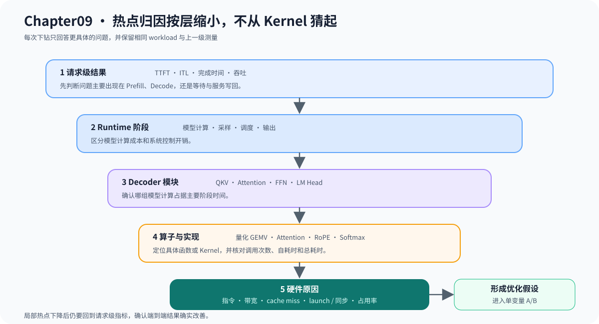

# 09.6 从阶段耗时定位到热点

热点归因沿着“总时间 → 阶段 → 函数或 Kernel → 硬件原因”逐步缩小。每一步都要保留上一级测量，避免局部加速后端到端结果没有变化。

| 层级 | 可观察对象 | 下一步判断 |
| --- | --- | --- |
| 请求 | TTFT、ITL、完成时间 | Prefill、Decode 还是等待 |
| Runtime | 模型计算、采样、调度、输出 | 计算路径还是系统开销 |
| Decoder | QKV、Attention、FFN、LM Head | 哪组算子占主导 |
| 算子 | GEMM、归一化、RoPE、Softmax | 计算、带宽或布局问题 |
| Kernel/函数 | 指令、访存、同步、launch | 是否值得改实现 |

下图展示一次完整的下钻顺序。只有上一级证据确认范围后，才进入更细的函数、Kernel 或硬件指标；局部优化完成后还要回到请求级指标复测。

## 用数据解释而不是猜测

热点表至少记录符号、调用次数、自耗时、总耗时和对应 workload。没有工作负载身份的热点截图不能作为本教程的优化结论。

| 证据 | 可以支持的判断 | 不能直接推出 |
| --- | --- | --- |
| 阶段占比高 | 优先继续分析该阶段 | 该阶段一定能优化 |
| 内存带宽接近上限 | 访存可能主导 | 增加线程一定更快 |
| Kernel launch 数量多 | 启动开销值得核对 | 融合后一定改善端到端延迟 |
| SIMD/CUDA 路径更快 | 当前 workload 下局部有效 | 所有模型和 shape 都更快 |

## 记录归因证据

先运行 `bash code/chapter09_performance/scripts/run_real_evidence.sh profile`，确认阶段文件可以回指 workload；需要继续下钻 CPU 函数时，再对同一可执行文件和输入使用 `perf record`。归因结果应在[实验资产索引](../../reference/experiment_assets.md)中指向原始文件和复现入口，而不是只保留截图。

当阶段、函数和硬件指标支持同一个优化假设时，进入 `09.7`；若不能回指相同 workload，不得进入 A/B 结论。
