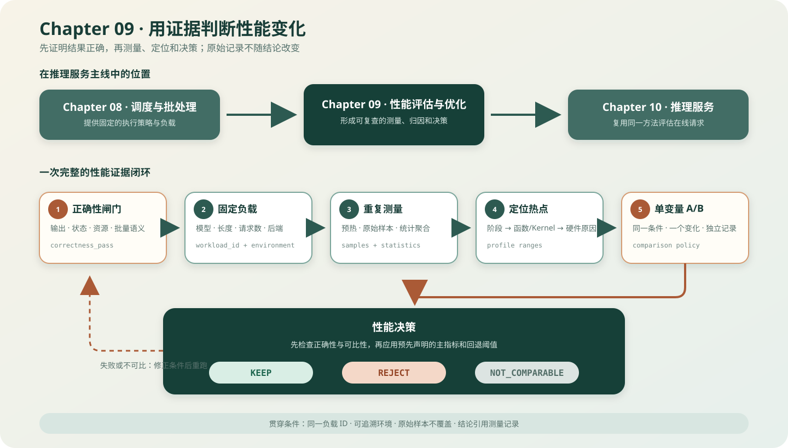

# 09.0 用证据判断性能变化

## 本章导读

前八章已经提供模型执行、缓存和调度路径。本章先固定输入、输出和运行环境，再测量延迟、吞吐与内存；发现变化后，用性能剖析缩小范围，最后通过单变量 A/B 实验决定保留或回退修改。Chapter09 不进入运行时调用链：Chapter08 和 Chapter10 产生样本，本章定义怎样记录、比较和解释这些样本。

| 章节 | 运行时角色 | 主要产物 | 核心验证 |
| --- | --- | --- | --- |
| Chapter08 | 在一个模型步内选择请求并组织批量执行 | `StepBatchPlan`、优先级策略、批执行器交接 | 候选顺序、缓存事务、批量结果 |
| Chapter09 | 对执行和服务结果建立可复查证据 | 负载、样本、统计、A/B 决定 | 记录完整、实验可比、结论可回归 |
| Chapter10 | 管理请求进入、连接、终态和资源释放 | `ServiceCore`、HTTP/SSE、指标 | 准入、取消、写回、释放和真实服务 |

| 学习线 | 本章怎样学习 | 可验证产物 |
| --- | --- | --- |
| A 测量 | 从正确性闸门进入固定负载，记录样本并聚合指标 | 可复现的测量记录 |
| B 归因与决策 | 从阶段耗时进入热点分析，再做单变量 A/B | 可比较的实验记录与 KEEP/REJECT 结论 |
| G GPU 坐标 | 沿用证据身份，分别记录 Nsight 热点和真实端到端 A/B | 融合量化 GEMV 剖析、Attention 预填充/解码样本与默认路径决策 |
| M 多模态坐标 | 固定图片、预处理和文本输入后，分开记录视觉阶段与语言阶段 | CPU 动态图片服务基准；CUDA 图文生成、服务与双请求解码组批正确性证据 |

| 本章新术语 | 先这样理解 | 首次解释 |
| --- | --- | --- |
| 负载（workload） | 一组固定的模型、输入、输出长度和并发条件 | [`09.1 正确性与负载`](./01_correctness_workload.md) |
| 墙钟时间（wall-clock time） | 从入口到结果可用按真实时钟经过的时间 | [`09.3 指标`](./03_metrics.md) |
| 首词元延迟（TTFT） | 从请求进入到第一个输出词元可用的时间 | [`09.3 指标`](./03_metrics.md) |
| 词元间延迟（ITL） | 流式生成中相邻输出词元之间的时间 | [`09.3 指标`](./03_metrics.md) |
| 性能剖析（Profiling） | 把总耗时拆到阶段、函数或 Kernel | [`09.5 工具顺序`](./05_profiling_tools.md) |

Chapter09 从请求调用链之外观察各阶段；它与运行对象的关系见 [Chapter06–10 跨章协作图](../../chapter06_generation/next/intro.md#跨章协作)。

## 开始学习

先确认输出正确，再学习怎样固定负载、保留逐轮样本和判断两次实验是否可比。性能剖析解释时间花在哪里，A/B 比较决定是否保留修改，两类证据共同支持结论。

| 顺序 | 路线 | 页面 | 先看源码 | 读完后应得到什么 |
| --- | --- | --- | --- | --- |
| 1 | A | [`09.1 正确性与负载`](./01_correctness_workload.md)、[`09.2 实验入口`](./02_benchmark_setup.md) | <a href="https://github.com/datawhalechina/cpp-llm-engine/blob/main/code/chapter09_performance/src/evidence_record.cpp"><code>evidence_record.cpp</code></a> | 哪些条件必须固定，错误结果为何不能进入性能比较 |
| 2 | A | [`09.3 指标`](./03_metrics.md)、[`09.4 统计与记录`](./04_statistics_schema.md) | <a href="https://github.com/datawhalechina/cpp-llm-engine/blob/main/code/chapter09_performance/src/statistics.cpp"><code>statistics.cpp</code></a> | 原始样本怎样变成可复查的聚合结果 |
| 3 | B | [`09.5 工具顺序`](./05_profiling_tools.md)、[`09.6 热点归因`](./06_hotspot_attribution.md) | <a href="https://github.com/datawhalechina/cpp-llm-engine/blob/main/code/engine/scripts/run_real_decoder_profile.sh"><code>run_real_decoder_profile.sh</code></a> | 应该先看总量、阶段、函数还是 Kernel |
| 4 | B | [`09.7 单变量 A/B`](./07_ab_experiment.md)、[`09.8 决策与回归`](./08_decision_regression.md) | <a href="https://github.com/datawhalechina/cpp-llm-engine/blob/main/code/chapter09_performance/src/comparison.cpp"><code>comparison.cpp</code></a> | 如何判断两次实验可比并形成保留或回退结论 |
| 5 | G | [`GPU 实验资产`](../../reference/experiment_assets.md#exp-gpu-02) | <a href="https://github.com/datawhalechina/cpp-llm-engine/blob/main/code/chapter09_performance/scripts/run_cuda_profile.sh"><code>run_cuda_profile.sh</code></a>、<a href="https://github.com/datawhalechina/cpp-llm-engine/blob/main/code/chapter09_performance/scripts/run_cuda_attention_ab.sh"><code>run_cuda_attention_ab.sh</code></a> | 计算核剖析为什么不能替代真实预填充/解码 A/B 决策 |
| 6 | G | [`自适应 GEMV 决策`](../../reference/experiment_assets.md#exp-gpu-14) | <a href="https://github.com/datawhalechina/cpp-llm-engine/blob/main/code/chapter09_performance/scripts/run_cuda_adaptive_gemv_ab.sh"><code>局部原因</code></a>、<a href="https://github.com/datawhalechina/cpp-llm-engine/blob/main/code/chapter09_performance/scripts/run_cuda_adaptive_gemv_runtime_ab.sh"><code>真实 Decode</code></a>、<a href="https://github.com/datawhalechina/cpp-llm-engine/blob/main/code/chapter09_performance/scripts/run_cuda_adaptive_gemv_runtime_matrix.sh"><code>范围矩阵</code></a> | 局部优化怎样经过端到端决策和适用范围验证后进入默认路径 |
| 7 | B/MoE | [`MoE 分组实验`](../../reference/experiment_assets.md#exp-cpu-13) | <a href="https://github.com/datawhalechina/cpp-llm-engine/blob/main/code/chapter09_performance/scripts/run_qwen15_moe_grouped_batch_ab.sh"><code>run_qwen15_moe_grouped_batch_ab.sh</code></a>、<a href="https://github.com/datawhalechina/cpp-llm-engine/blob/main/code/chapter09_performance/scripts/run_deepseek2_moe_batch_runtime_ab.sh"><code>DeepSeek Runtime A/B</code></a> | 怎样从局部专家计算逐步验证完整解码、调度和服务收益 |
| 8 | G/MoE | [`DeepSeek CUDA 分组实验`](../../reference/experiment_assets.md#exp-gpu-17) | <a href="https://github.com/datawhalechina/cpp-llm-engine/blob/main/code/chapter09_performance/scripts/run_deepseek2_cuda_grouped_moe_ab.sh"><code>run_deepseek2_cuda_grouped_moe_ab.sh</code></a> | 正确的跨请求批执行为什么仍可能没有端到端收益 |
| 9 | G/MoE | [`设备 Router 与热点复测`](../../reference/experiment_assets.md#exp-gpu-31) | <a href="https://github.com/datawhalechina/cpp-llm-engine/blob/main/code/chapter09_performance/scripts/run_deepseek2_cuda_device_router_ab.sh"><code>Router A/B</code></a>、<a href="https://github.com/datawhalechina/cpp-llm-engine/blob/main/code/chapter09_performance/scripts/run_deepseek2_cuda_optimized_profile.sh"><code>默认路径 profile</code></a> | 用 A/B 决定默认值，再通过热点复测确认瓶颈变化 |
| 10 | 扩展 | [`09.9 框架对照`](./09_framework_comparison.md) | 生态卡 | 教学证据链与生产框架工具链的对应关系 |

## 验证与下一步

| 验收层级 | 执行入口 | 通过条件 | 适用阶段 |
| --- | --- | --- | --- |
| L1 证据结构 | `bash code/chapter09_performance/scripts/run.sh` | 记录校验、统计聚合、不可比输入和回退策略测试通过 | 学完本章必做 |
| L2 真实模型 | `bash code/chapter09_performance/scripts/run_real_evidence.sh service` | TinyLlama 原始样本进入统一证据，正确性闸门通过 | 本地有模型时执行 |
| L3 单变量决策 | `bash code/chapter09_performance/scripts/run_real_evidence.sh ab` | 两条路径保存独立原始样本，并输出可追溯的决策文件 | 修改默认实现前执行 |
| L4 专项扩展 | 按问题从[代码实验入口](https://github.com/datawhalechina/cpp-llm-engine/blob/main/code/chapter09_performance/README.md#选择实验入口)选择脚本 | 模型、负载和正确性一致，局部原因与端到端结论分别留证 | 学习 CUDA、MoE 或多模态时选做 |

L1 证明记录格式、校验规则与决策逻辑可用，不表示当前机器上的性能数字可以推广到其他环境。具体模型的命令、实验编号、样本与结论统一由[实验资产登记表](../../reference/experiment_assets.md)维护，导读只保留学习者需要的验收层次。
