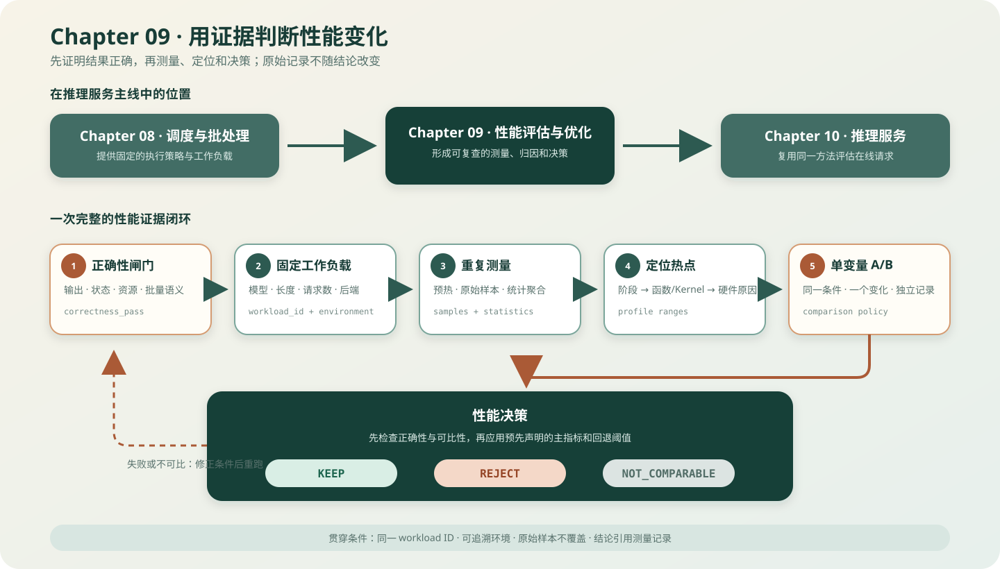

# 09.0 用证据判断性能变化

## 本章导读

前八章已经提供模型执行、缓存和调度路径。本章先固定输入、输出和运行环境，再测量延迟、吞吐与内存；发现变化后，用 Profiling 缩小范围，最后通过单变量 A/B 实验决定保留或回退修改。Chapter09 不进入运行时调用链：Chapter08 和 Chapter10 产生样本，本章定义怎样记录、比较和解释这些样本。

| 章节 | 运行时角色 | 主要产物 | 核心验证 |
| --- | --- | --- | --- |
| Chapter08 | 在一个模型 step 内选择请求并组织批量执行 | `StepBatchPlan`、优先级策略、batch runner 交接 | 候选顺序、缓存事务、批量结果 |
| Chapter09 | 对执行和服务结果建立可复查证据 | workload、样本、统计、A/B 决定 | 记录完整、实验可比、结论可回归 |
| Chapter10 | 管理请求进入、连接、终态和资源释放 | ServiceCore、HTTP/SSE、指标 | admission、取消、写回、释放和真实服务 |

| 学习线 | 本章怎样学习 | 可验证产物 |
| --- | --- | --- |
| A 测量 | 从正确性闸门进入固定工作负载，记录样本并聚合指标 | 可复现的测量记录 |
| B 归因与决策 | 从阶段耗时进入热点分析，再做单变量 A/B | 可比较的实验记录与 KEEP/REJECT 结论 |
| G GPU 坐标 | 沿用证据身份，分别记录 Nsight 热点和真实端到端 A/B | 融合量化 GEMV profile、Attention Prefill/Decode 样本与默认路径决策 |
| M 多模态坐标 | 固定图片、预处理和文本输入后复用服务指标 | 多模态 workload 定义；统一基线待建设 |

| 本章新术语 | 先这样理解 | 首次解释 |
| --- | --- | --- |
| 工作负载（workload） | 一组固定的模型、输入、输出长度和并发条件 | [`09.1 正确性与工作负载`](./01_correctness_workload.md) |
| 墙钟时间（wall-clock time） | 从入口到结果可用按真实时钟经过的时间 | [`09.3 指标`](./03_metrics.md) |
| 首词元延迟（TTFT） | 从请求进入到第一个输出词元可用的时间 | [`09.3 指标`](./03_metrics.md) |
| 词元间延迟（ITL） | 流式生成中相邻输出词元之间的时间 | [`09.3 指标`](./03_metrics.md) |
| 性能剖析（Profiling） | 把总耗时拆到阶段、函数或 Kernel | [`09.5 工具顺序`](./05_profiling_tools.md) |

## 开始学习

先从“错误输出不能进入性能比较”开始，再学习怎样固定 workload、保留逐轮样本和判断两次实验是否可比。Profiling 用于解释时间花在哪里，A/B 比较才负责决定是否保留修改；两类证据不能互相替代。

| 顺序 | 路线 | 页面 | 先看源码 | 读完后应得到什么 |
| --- | --- | --- | --- | --- |
| 1 | A | [`09.1 正确性与工作负载`](./01_correctness_workload.md)、[`09.2 实验入口`](./02_benchmark_setup.md) | <a href="https://github.com/datawhalechina/cpp-llm-engine/blob/main/code/chapter09_performance/src/evidence_record.cpp"><code>evidence_record.cpp</code></a> | 哪些条件必须固定，错误结果为何不能进入性能比较 |
| 2 | A | [`09.3 指标`](./03_metrics.md)、[`09.4 统计与记录`](./04_statistics_schema.md) | <a href="https://github.com/datawhalechina/cpp-llm-engine/blob/main/code/chapter09_performance/src/statistics.cpp"><code>statistics.cpp</code></a> | 原始样本怎样变成可复查的聚合结果 |
| 3 | B | [`09.5 工具顺序`](./05_profiling_tools.md)、[`09.6 热点归因`](./06_hotspot_attribution.md) | <a href="https://github.com/datawhalechina/cpp-llm-engine/blob/main/code/engine/scripts/run_real_decoder_profile.sh"><code>run_real_decoder_profile.sh</code></a> | 应该先看总量、阶段、函数还是 Kernel |
| 4 | B | [`09.7 单变量 A/B`](./07_ab_experiment.md)、[`09.8 决策与回归`](./08_decision_regression.md) | <a href="https://github.com/datawhalechina/cpp-llm-engine/blob/main/code/chapter09_performance/src/comparison.cpp"><code>comparison.cpp</code></a> | 如何判断两次实验可比并形成保留或回退结论 |
| 5 | G | [`GPU 实验资产`](../../reference/experiment_assets.md#exp-gpu-02) | <a href="https://github.com/datawhalechina/cpp-llm-engine/blob/main/code/chapter09_performance/scripts/run_cuda_profile.sh"><code>run_cuda_profile.sh</code></a>、<a href="https://github.com/datawhalechina/cpp-llm-engine/blob/main/code/chapter09_performance/scripts/run_cuda_attention_ab.sh"><code>run_cuda_attention_ab.sh</code></a> | kernel profile 为什么不能替代真实 Prefill/Decode A/B 决策 |
| 6 | G | [`自适应 GEMV 决策`](../../reference/experiment_assets.md#exp-gpu-14) | <a href="https://github.com/datawhalechina/cpp-llm-engine/blob/main/code/chapter09_performance/scripts/run_cuda_adaptive_gemv_ab.sh"><code>局部原因</code></a>、<a href="https://github.com/datawhalechina/cpp-llm-engine/blob/main/code/chapter09_performance/scripts/run_cuda_adaptive_gemv_runtime_ab.sh"><code>真实 Decode</code></a>、<a href="https://github.com/datawhalechina/cpp-llm-engine/blob/main/code/chapter09_performance/scripts/run_cuda_adaptive_gemv_runtime_matrix.sh"><code>范围矩阵</code></a> | 局部优化怎样经过端到端决策和适用范围验证后进入默认路径 |
| 7 | B/MoE | [`MoE 分组实验`](../../reference/experiment_assets.md#exp-cpu-13) | <a href="https://github.com/datawhalechina/cpp-llm-engine/blob/main/code/chapter09_performance/scripts/run_qwen15_moe_grouped_batch_ab.sh"><code>run_qwen15_moe_grouped_batch_ab.sh</code></a>、<a href="https://github.com/datawhalechina/cpp-llm-engine/blob/main/code/chapter09_performance/scripts/run_deepseek2_moe_batch_runtime_ab.sh"><code>DeepSeek Runtime A/B</code></a> | 怎样从局部专家计算逐步验证完整解码、调度和服务收益 |
| 8 | 扩展 | [`09.9 框架对照`](./09_framework_comparison.md) | 生态卡 | 教学证据链与成熟框架工具链的对应关系 |

## 验证与下一步

| 验收层级 | 执行入口 | 通过条件 | 本章要求 |
| --- | --- | --- | --- |
| L1 数据格式与校验 | `bash code/chapter09_performance/scripts/run.sh` | 记录校验、统计聚合、不可比输入和回退策略测试通过 | 必做 |
| L2 旧证据迁移 | `node code/chapter09_performance/scripts/import_legacy_evidence.mjs ...` | 保留逐轮样本的旧结果转换成功，聚合历史结果被拒绝 | 迁移期间必做 |
| L3 真实模型 | `bash code/chapter09_performance/scripts/run_real_evidence.sh service` | TinyLlama 原始样本转换为统一 evidence，正确性闸门通过 | 有模型时必做 |
| L4 服务 A/B | `bash code/chapter09_performance/scripts/run_real_evidence.sh ab` | 保留顺序与并行原始样本、统一 evidence，并输出 `real-service-ab-decision.json` | 进入 Chapter10 后完成 |
| L5 MoE 缓存 A/B | `bash code/chapter09_performance/scripts/run_qwen15_moe_layer_cache.sh` | 两种路径生成词元一致，同时记录命中、常驻字节和 Prefill/Decode 时延 | 有 Qwen1.5-MoE 时选做 |
| L6 MoE 专家分组 A/B | `bash code/chapter09_performance/scripts/run_qwen15_moe_grouped_batch_ab.sh` | 逐词元与按专家分组使用相同路由，输出误差通过并保留配对样本 | 学习 MoE 批执行时选做 |
| L7 DeepSeek MoE Runtime A/B | `bash code/chapter09_performance/scripts/run_deepseek2_moe_batch_runtime_ab.sh` | 五轮反向顺序配对通过 logits、余弦和词元闸门，并保存原始样本 | 学习 MLA 与 MoE 组批时选做 |
| L8 MoE 动态准入 A/B | `bash code/chapter09_performance/scripts/run_qwen15_moe_service_ab.sh` | 运行中加入请求后，两条路径的完整输出、批量执行和终态释放一致 | 学习 MoE 服务时选做 |
| L9 CUDA 热点 | `bash code/chapter09_performance/scripts/run_cuda_profile.sh` | 固定模型、词元和设备信息，保存 kernel/memory CSV 与 golden token | 有 Nsight Systems 时选做 |
| L10 CUDA Attention A/B | `bash code/chapter09_performance/scripts/run_cuda_attention_ab.sh` | 两轮独立 Prefill/Decode 样本和正确性检查完整；不稳定收益不会进入默认路径 | 调优融合 Attention 时必做 |
| L11 CUDA 自适应 GEMV 原因 | `bash code/chapter09_performance/scripts/run_cuda_adaptive_gemv_ab.sh` | 固定 4 行与自适应 tile 的正确性、cycles、指令和共享内存指标完整 | 调整量化 GEMV 策略时必做 |
| L12 CUDA 自适应 GEMV 决策 | `bash code/chapter09_performance/scripts/run_cuda_adaptive_gemv_runtime_ab.sh`、`run_cuda_adaptive_gemv_runtime_matrix.sh` | 真实 Decode 输出 `KEEP`，batch/context/step 矩阵全部通过正确性和配对顺序检查 | 改变默认路径前必做 |

L1 构建证据记录、统计和比较器，并运行六项测试；它证明记录格式、校验规则与决策逻辑可用，不代表当前机器上的性能数字可以直接推广到其他环境。

局部专家分组通过后，可以继续运行完整 Decoder、批量范围、多步 Decode 和 Chapter08 固定队列实验；入口与适用边界集中列在 <a href="https://github.com/datawhalechina/cpp-llm-engine/blob/main/code/chapter09_performance/README.md"><code>code/chapter09_performance/README.md</code></a>。
