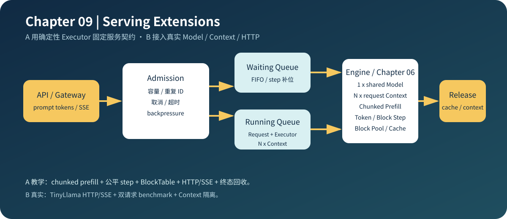

# 09.0 构建推理服务核心与 HTTP 接口

## 本章导读

Chapter06 已经能够推进生成请求，Chapter07–08 已经能够测量和解释 CPU 行为；本章把同一个 `Request` 接入 C++ `ServiceCore`，增加准入、队列、资源回收、指标和 HTTP/SSE 适配。

学习完成后，应能观察容量拒绝、动态 step、取消与超时、终态资源释放、在线延迟和真实模型输出。网络库只负责请求解析与响应写出，模型、调度和资源状态继续由 `ServiceCore` 与 Generation Runtime 管理。

| 学习线 | 本章怎样学习 | 可验证产物 |
| --- | --- | --- |
| A 教学证据线 | 用确定性 Executor 验证 admission、队列、取消、超时、metrics 和 transport-neutral writer | 固定状态码、终态计数、HTTP/SSE contract 和资源回收 |
| B 真实执行线 | 接入共享 TinyLlama Model 和独立 Context，运行真实 ServiceCore、HTTP 和双请求 benchmark | golden token、Context 隔离、在线响应与真实阶段结果 |

| 服务对象 | 当前实现 | 继续扩展时关注什么 |
| --- | --- | --- |
| 准入与队列 | 容量、重复 ID、FIFO waiting、动态补位 | 优先级、deadline 和抢占 |
| 模型执行 | 共享 Model、独立 Executor/Context、请求级 CPU 并发 | ServiceCore 接入真实 batch、专用并行 backend |
| 资源管理 | 请求 cache、连续模型 K/V、物理 block ID 回收、独立 CPU 分页 payload | 真实 Model Context 接入分页 payload 与 workspace pool |
| HTTP completion | 同步 token ID、SSE token event、错误映射 | 文本 API、鉴权、背压和异步 transport |
| 可观测性 | queue wait、TTFT、completion `_sum/_count` | histogram、P50/P99 和 trace |
| Benchmark | 双请求阶段耗时、正确性、串行/并行 A/B | 开放环负载与 ServiceCore batch A/B |



## 开始学习

先运行 transport-neutral 的默认入口：

```bash
bash code/chapter09_serving/scripts/run.sh
```

| 顺序 | 路线 | 页面与源码 | 读完后应看到什么 |
| --- | --- | --- | --- |
| 1 | A/B 公共 | [`09.1 C++ 服务核心`](./01_service_core.md)、<a href="../_code/chapter09_serving/include/chapter09_serving/serving_core.h"><code>serving_core.h</code></a> | admission、waiting/running、dispatch 和 release 怎样推进 |
| 2 | A→B | [`09.4 HTTP Completion`](./04_real_http_completion.md)、[`09.2 Transport 与网络库`](./02_transport.md) | Factory、同步响应、SSE 和网络 writer 怎样保持同一服务语义 |
| 3 | B | [`09.3 真实 ServiceCore`](./03_real_service_benchmark.md) | 模型计算、Runtime 开销和请求级并发怎样分别计时 |
| 4 | A/B 对照 | [`09.5 成熟框架对照`](./05_framework_service_comparison.md) | 教学对象怎样映射到 vLLM、SGLang 与 llama.cpp server |

进阶页面依赖 Chapter06 的 [`连续批处理`](../chapter06_generation/10_continuous_batching.md)、[`真实模型批量执行`](../chapter06_generation/11_real_model_batch.md)和[`分块 KV Cache`](../chapter06_generation/12_block_kv_cache.md)。真实 socket 回环、真实模型 benchmark 和 HTTP server 使用各页面列出的可选脚本。

## 验证与下一步

默认验收检查 `QueueFull`、`DuplicateId`、取消/超时、部分预填充游标、在线延迟、cache 与 block 回收、HTTP/SSE 状态和 transport-neutral contract。真实模型验收再检查 golden token、Context 隔离、Executor 释放和 benchmark JSON。

当前请求级并发已经证明两个 Executor 可以重叠，但 ServiceCore 还没有调用 Chapter06 的真实 batch，也没有把真实 TinyLlama Context 绑定到 `CpuPagedKvCache`。两项能力应分别通过批量 Decoder A/B 和连续/Paged KV logits 对照后，才能写入服务能力结论。
