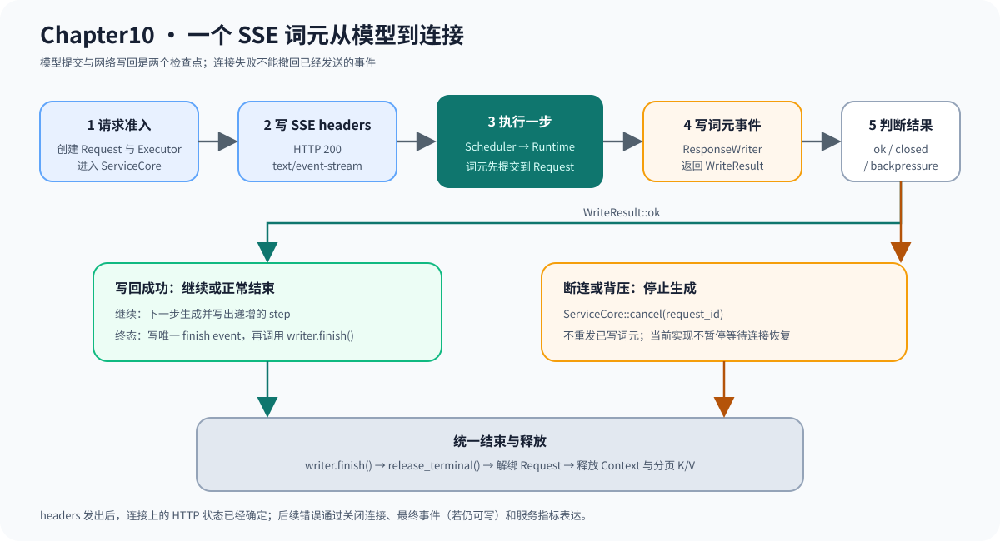

# 10.6 处理 SSE、断连和写回背压

SSE 在 headers 发出后持续写入词元事件。<a href="https://github.com/datawhalechina/cpp-llm-engine/blob/main/code/chapter10_serving/include/chapter10_serving/response_writer.h"><code>ResponseWriter</code></a> 把正常写入、客户端断开和背压返回为显式结果。此时 HTTP 状态码已经确定，后续断连、超时或模型失败只能通过连接关闭、最终事件和服务指标表达。

## Writer 必须保证什么

| 方法或结果 | 含义 | ServiceCore 动作 |
| --- | --- | --- |
| `write_headers` | 建立流式响应 | 失败则取消请求 |
| `write_event` → Ok | 当前词元已交给 Transport | 继续执行 |
| `write_event` → ClientClosed | 客户端不再接收 | 标记 Cancelled |
| `write_event` → Backpressure | 暂时无法写出 | 当前取消请求并释放资源 |
| `finish` | Transport 结束响应 | 不重复释放模型资源 |

下图把模型词元提交和网络写回分成两个检查点。词元进入 Request 后才调用 Writer；如果连接在此时断开，服务停止后续生成并释放资源，但不会重发已经成功写出的事件。

## 词元事件必须保持顺序

每个 event 携带 request ID 隐含的连接归属、token 和 step。Worker 可以并发产生不同请求的事件，但同一请求不能重排、重复或在终态后继续发送。

| 验证场景 | 通过条件 |
| --- | --- |
| 正常流 | token step 单调，最终 `stop` 只出现一次 |
| 首词元前断连 | 不写 token，服务资源释放 |
| 中途断连 | 已发 token 不重发，后续执行停止 |
| Deadline | 进入 TimedOut，不再 decode |
| 背压 | 当前停止生成、取消请求并释放，不静默丢 token |

真正的暂停与恢复需要 Transport 在连接重新可写时通知 ServiceCore，并要求 Scheduler 暂时排除该请求，同时保留 Request、Executor 和已提交 K/V。当前同步 Writer 没有可写事件，因此不能把“检测到背压”解释成已经实现异步流量控制。

## 验证事件顺序和断连

运行 `bash code/chapter10_serving/scripts/run.sh`。`chapter10_http_contract_test` 应检查 headers 只写一次、token step 单调、终止事件唯一，以及 ClientClosed/Backpressure 转换为取消和释放。该测试证明当前同步写出规则，不证明暂停恢复已实现。`10.7` 继续区分连接、请求和模型批次的并发。
