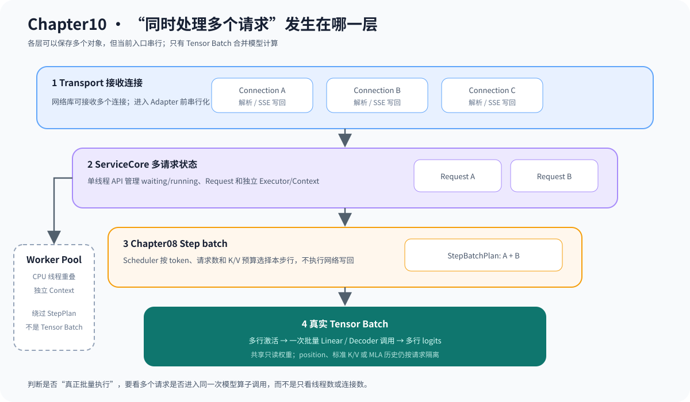

# 10.7 区分连接并发、请求并发和 Tensor Batch

“同时处理多个请求”可能发生在不同层。连接线程并发不等于模型并行，<a href="../../_code/chapter10_serving/src/request_worker.cpp"><code>RequestWorkerPool</code></a> 的请求级重叠也不等于一次 Tensor batch 调用。

| 并发层级 | 实际发生什么 | 当前证据 |
| --- | --- | --- |
| Transport 并发 | 多个连接同时解析或写回 | 网络库回环与隔离测试 |
| ServiceCore 并发 | waiting/running 中存在多个请求 | admission 与状态测试 |
| 请求级 Worker | 独立 Executor/Context 在 CPU 线程重叠 | sequential/parallel A/B |
| Step batch | 一个调度步选择多个请求 | Chapter08 StepBatchPlan |
| Tensor batch | 多行激活进入一次模型/算子调用 | Chapter08 批量执行证据 |

下图从连接入口一直追踪到模型调用。连接、请求和 Worker 可以同时存在多个对象，但只有多个请求的激活进入同一次模型调用时，才属于真实 Tensor Batch。

## 并发对象必须隔离

共享 Model 权重可以只读复用，每个请求的 token history、位置、Sampler 状态、Context 和 K/V 所有权必须独立。ServiceCore 只把可运行集合提交给 Scheduler，不在 Worker 内复制全局队列。

| 可以共享 | 必须请求私有 |
| --- | --- |
| Model 权重、只读配置、Kernel 实现 | Request、Executor/Context、K/V 页表 |
| 模型权重、只读调度配置 | Deadline、流式 Writer、错误状态 |
| 统计定义 | 单请求时间戳和词元顺序 |

`RequestWorkerPool` 证明两个独立 Context 可以在 CPU 线程中重叠执行，但它绕过 StepBatchPlan，且使用 BlockPool 时会拒绝运行。Chapter08 Tensor batch 则把多行激活交给同一次模型调用。两条路径回答不同问题，不能用 Worker 并发结果代替批量模型执行证据。

## 验证并发隔离

运行 `bash code/chapter10_serving/scripts/run.sh`。<a href="../../_code/chapter10_serving/tests/request_worker_test.cpp"><code>chapter10_request_worker_test</code></a> 应证明多个请求可以在独立 Context 上并发、结果不串扰，并在不支持的 BlockPool 组合下显式拒绝。`10.8` 从这些请求的状态时间点产生可观测证据。
