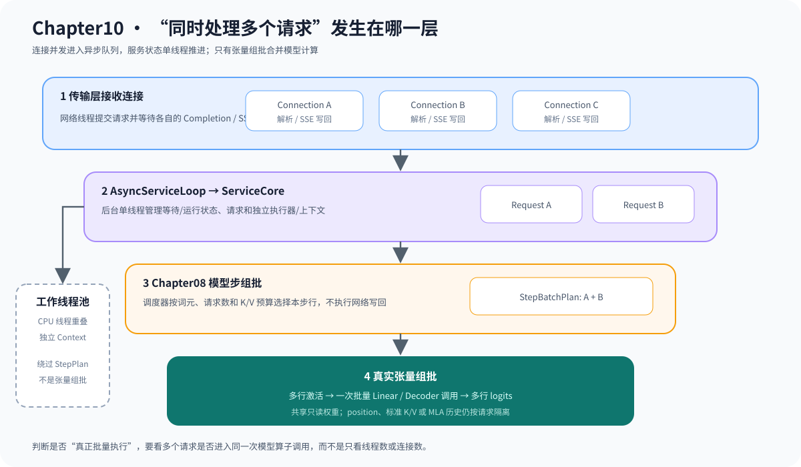

# 10.7 区分连接并发、请求并发和张量组批

“同时处理多个请求”可能发生在不同层。连接线程并发表示网络层可同时接入；<a href="https://github.com/datawhalechina/cpp-llm-engine/blob/main/code/chapter10_serving/src/request_worker.cpp"><code>RequestWorkerPool</code></a> 表示多个独立上下文在线程中重叠；张量组批则表示多个请求进入同一次模型调用。

| 并发层级 | 实际发生什么 | 当前证据 |
| --- | --- | --- |
| 传输层接入 | 网络库接收多个连接并投递类型化请求 | cpp-httplib 回环 |
| 异步服务循环 | 网络线程等待各自结果；后台单线程修改服务状态 | `chapter10_async_service_test` |
| `ServiceCore` 多请求状态 | 等待/运行集合保存多个请求，API 由事件循环单线程调用 | 准入与状态测试 |
| 请求级工作线程 | 独立执行器与上下文在 CPU 线程重叠 | 顺序/并行 A/B |
| 模型步组批 | 一个调度步选择多个请求 | Chapter08 `StepBatchPlan` |
| 张量组批 | 多行激活进入一次模型或算子调用 | Chapter08 批量执行证据 |

下图从连接入口一直追踪到模型调用。多个连接可以并发调用异步 Adapter，但只有后台事件循环调用 `ServiceCore`。`ServiceCore` 保存多个请求不等于张量组批；多个请求的激活进入同一次模型调用时，才属于张量组批。

事件循环默认收到请求就开始调度。模型入口也可以设置一个很短的提交收集窗口：服务空闲时先等待同批请求到达，再一次交给 `ServiceCore`。窗口越长，形成批次的机会越多，首个请求的排队延迟也越高。SmolVLM 验收使用 10 ms 窗口稳定收集两个图文请求；通用服务默认保持 0 ms。

## 并发对象必须隔离

共享 Model 权重可以只读复用，每个请求的 token history、位置、Sampler 状态、Context 和 K/V 所有权必须独立。ServiceCore 只把可运行集合提交给 Scheduler，不在 Worker 内复制全局队列。

| 可以共享 | 必须请求私有 |
| --- | --- |
| Model 权重、只读配置、Kernel 实现 | Request、Executor/Context、K/V 页表 |
| 模型权重、只读调度配置 | Deadline、流式 Writer、错误状态 |
| 统计定义 | 单请求时间戳和词元顺序 |

`RequestWorkerPool` 证明两个独立上下文可以在 CPU 线程中重叠执行，但它绕过 `StepBatchPlan`，且使用 `BlockPool` 时会拒绝运行。Chapter08 张量组批则把多行激活交给同一次模型调用。两条路径分别验证线程隔离和模型批执行，结果不可互相替代。

## 验证并发隔离

运行 `bash code/chapter10_serving/scripts/run.sh`。`chapter10_async_service_test` 检查并发 HTTP 调用、事件隔离、准入结果和资源释放；<a href="https://github.com/datawhalechina/cpp-llm-engine/blob/main/code/chapter10_serving/tests/request_worker_test.cpp"><code>chapter10_request_worker_test</code></a> 检查独立 CPU Context 的线程重叠。`10.8` 从这些请求的状态时间点产生可观测证据。
