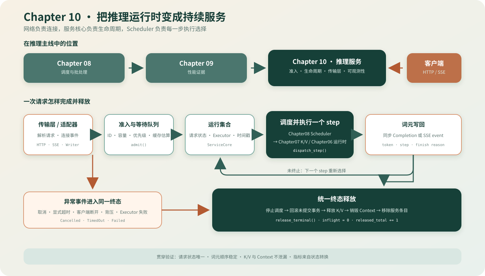

# 10.0 把推理运行时变成持续服务

## 本章导读

Chapter06 定义单请求生成，Chapter07 管理 K/V 资源，Chapter08 选择每步执行批次，Chapter09 提供性能证据。本章增加准入、等待、取消、网络写回和指标，让多个请求通过统一接口进入同一推理实例。

| 学习线 | 本章怎样学习 | 可验证产物 |
| --- | --- | --- |
| A 服务生命周期 | 从准入进入等待与运行状态，再处理取消、超时、失败和统一释放 | 固定状态转换、容量结果和资源归零 |
| B 网络与并发 | 把 Completion/SSE 映射到 ServiceCore；比较稠密、MoE 和 MLA-MoE 模型怎样复用服务生命周期 | TinyLlama/Qwen3 HTTP 验证、Qwen1.5-MoE 动态准入、DeepSeek HTTP/SSE 与指标检查 |
| G GPU 扩展坐标 | 保持 ServiceCore 生命周期不变，把 Executor 替换为设备后端 | TinyLlama、Qwen3 与 DeepSeek 已通过 CUDA 服务测试；DeepSeek 文本入口同时连接分页 MLA 与真实 Tokenizer |
| M 多模态扩展坐标 | 通过请求准备器构造图文嵌入执行器，再复用同一服务生命周期 | JSON/Base64 图片、图文生成、同步/SSE 和双请求 Prefill/Decode 组批已经验证 |

| 本章新术语 | 先这样理解 | 首次解释 |
| --- | --- | --- |
| 准入（admission） | 请求进入服务前的容量与合法性检查 | [`10.2 准入与背压`](./02_admission_backpressure.md) |
| 传输层（transport） | 处理连接和 HTTP 字节，不执行模型 | [`10.4 Transport`](./04_transport.md) |
| SSE | 通过一个 HTTP 响应持续发送词元事件 | [`10.6 流式输出`](./06_sse_disconnect.md) |
| 异步服务循环 | 网络线程提交请求，后台单线程持续推进调度 | [`10.7 并发`](./07_concurrency_workers.md) |
| 背压（backpressure） | 下游暂时写不动；当前实现取消请求并释放资源 | [`10.6 流式输出`](./06_sse_disconnect.md) |

本章在完整请求生命周期中的位置见 [Chapter06–10 跨章协作图](../../chapter06_generation/next/intro.md#跨章协作)。

## 开始学习

先沿 A 线跟踪请求所有权，再沿 B 线观察 HTTP/SSE 如何驱动同一生命周期。最后比较请求级工作线程与 Chapter08 张量组批，区分连接接入、线程重叠和模型批量执行。

| 顺序 | 路线 | 页面 | 先看源码 | 读完后应看到什么 |
| --- | --- | --- | --- | --- |
| 1 | A | [`10.1 ServiceCore`](./01_service_core.md)–[`10.3 终态释放`](./03_terminal_release.md) | <a href="https://github.com/datawhalechina/cpp-llm-engine/blob/main/code/chapter10_serving/src/service_core.cpp"><code>service_core.cpp</code></a> | 请求怎样进入、停止并释放所有权 |
| 2 | B | [`10.4 Transport`](./04_transport.md)–[`10.6 SSE`](./06_sse_disconnect.md) | <a href="https://github.com/datawhalechina/cpp-llm-engine/blob/main/code/chapter10_serving/src/http_adapter.cpp"><code>http_adapter.cpp</code></a>、<a href="https://github.com/datawhalechina/cpp-llm-engine/blob/main/code/chapter10_serving/include/chapter10_serving/response_writer.h"><code>response_writer.h</code></a> | 请求、断连和写回失败怎样映射为服务终态 |
| 3 | B | [`10.7 并发`](./07_concurrency_workers.md)、[`10.8 可观测性`](./08_observability.md) | <a href="https://github.com/datawhalechina/cpp-llm-engine/blob/main/code/chapter10_serving/tests/request_worker_test.cpp"><code>request_worker_test.cpp</code></a> | 请求线程并发、张量组批和指标口径的区别 |
| 4 | A/B | [`10.9 真实模型验证`](./09_real_model_validation.md)、[`10.10 框架对照`](./10_framework_comparison.md) | `code/engine` 真实模型入口、生态卡 | 单机服务对象怎样映射到生产框架 |

## 验证与下一步

| 验收层级 | 执行入口 | 通过条件 | 适用阶段 |
| --- | --- | --- | --- |
| L1 生命周期 | `bash code/chapter10_serving/scripts/run.sh` | 准入、执行、取消、超时、HTTP/SSE 接口、释放和指标测试通过 | 学完本章必做 |
| L2 套接字回环 | `bash code/chapter10_serving/scripts/run_cpp_httplib_loopback.sh` | health、metrics、Completion 和 SSE 通过 | 本地可准备 cpp-httplib 时执行 |
| L3 真实 CPU 服务 | `bash code/engine/scripts/run_real_http_server.sh --check` | TinyLlama 固定结果、上下文隔离和资源释放通过 | 本地有模型时执行 |
| L4 模型与设备扩展 | 按[代码 README](https://github.com/datawhalechina/cpp-llm-engine/blob/main/code/chapter10_serving/README.md#运行与验证)选择 Qwen、MoE、DeepSeek、CUDA 或 SmolVLM 入口 | 所选模型的同步/流式输出、请求隔离、组批计数和终态释放符合能力声明 | 学习扩展路线时选做 |

L1 入口会构建 Chapter06–08 依赖与 `chapter10_serving`，再运行服务核心、终态释放、HTTP/SSE、异步事件循环、请求准备收集器和请求工作线程六组测试。各模型当前支持的 CPU、CUDA、生成与服务层级见[模型支持矩阵](../../reference/model_support.md)。
