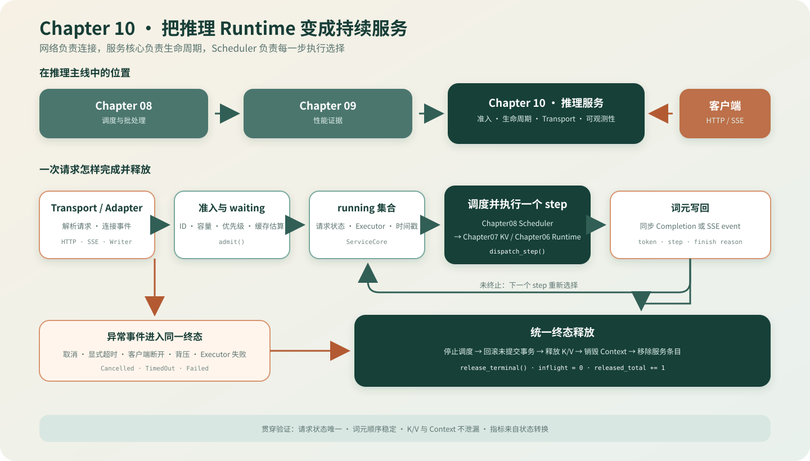

# 10.0 把推理 Runtime 变成持续服务

## 本章导读

Chapter06 定义单请求生成，Chapter07 管理 K/V 资源，Chapter08 选择每步执行批次，Chapter09 提供性能证据。本章在这些对象外增加准入、等待、取消、网络写回和指标，让多个请求能够通过稳定接口进入同一推理实例。

| 学习线 | 本章怎样学习 | 可验证产物 |
| --- | --- | --- |
| A 服务生命周期 | 从 admission 进入 waiting/running，再处理取消、超时、失败和统一释放 | 固定状态转换、容量结果和资源归零 |
| B 网络与并发 | 把 Completion/SSE 映射到 ServiceCore，再验证 Worker、断连和请求隔离 | HTTP 状态、词元顺序、请求级并发与指标契约 |

| 本章新术语 | 先这样理解 | 首次解释 |
| --- | --- | --- |
| 准入（admission） | 请求进入服务前的容量与合法性检查 | [`10.2 准入与背压`](./02_admission_backpressure.md) |
| 传输层（transport） | 处理连接和 HTTP 字节，不执行模型 | [`10.4 Transport`](./04_transport.md) |
| SSE | 通过一个 HTTP 响应持续发送词元事件 | [`10.6 流式输出`](./06_sse_disconnect.md) |
| 背压（backpressure） | 下游暂时写不动；当前实现取消请求并释放资源 | [`10.6 流式输出`](./06_sse_disconnect.md) |



## 开始学习

先运行 Chapter10 独立入口：

```bash
bash code/chapter10_serving/scripts/run.sh
```

脚本构建 Chapter06–08 依赖与 `chapter10_serving`，再运行 ServiceCore、终态释放、HTTP/SSE 契约和请求 Worker 四个测试。CTest 全部通过表示准入、调度交接、取消/超时、写回失败和并发隔离符合当前契约。

| 顺序 | 路线 | 页面 | 先看源码 | 读完后应看到什么 |
| --- | --- | --- | --- | --- |
| 1 | A | [`10.1 ServiceCore`](./01_service_core.md)–[`10.3 终态释放`](./03_terminal_release.md) | <a href="../../_code/chapter10_serving/src/service_core.cpp"><code>service_core.cpp</code></a> | 请求怎样进入、停止并释放所有权 |
| 2 | B | [`10.4 Transport`](./04_transport.md)–[`10.6 SSE`](./06_sse_disconnect.md) | <a href="../../_code/chapter10_serving/src/http_adapter.cpp"><code>http_adapter.cpp</code></a>、<a href="../../_code/chapter10_serving/include/chapter10_serving/response_writer.h"><code>response_writer.h</code></a> | 请求、断连和写回失败怎样映射为服务终态 |
| 3 | B | [`10.7 并发`](./07_concurrency_workers.md)、[`10.8 可观测性`](./08_observability.md) | <a href="../../_code/chapter10_serving/tests/request_worker_test.cpp"><code>request_worker_test.cpp</code></a> | 请求线程并发、Tensor batch 和指标口径的区别 |
| 4 | A/B | [`10.9 真实模型验证`](./09_real_model_validation.md)、[`10.10 框架对照`](./10_framework_comparison.md) | Engine 真实模型入口、生态卡 | 教学闭环怎样连接生产服务架构 |

## 验证与下一步

| 验收层级 | 执行入口 | 通过条件 | 本章要求 |
| --- | --- | --- | --- |
| L1 ServiceCore | `bash code/chapter10_serving/scripts/run.sh` | 准入、step dispatch、取消、超时、释放与指标通过 | 必做 |
| L2 HTTP/SSE | 同一入口的 adapter/writer 测试 | 状态码和词元顺序正确，断连或背压后取消并释放 | 必做 |
| L3 Socket 回环 | `bash code/chapter10_serving/scripts/run_cpp_httplib_loopback.sh` | health、metrics、Completion 和 SSE 通过 | 可选 |
| L4 真实模型 | `bash code/engine/scripts/run_real_http_server.sh --check` | TinyLlama golden、Context 隔离和资源释放通过 | 有模型时必做 |
