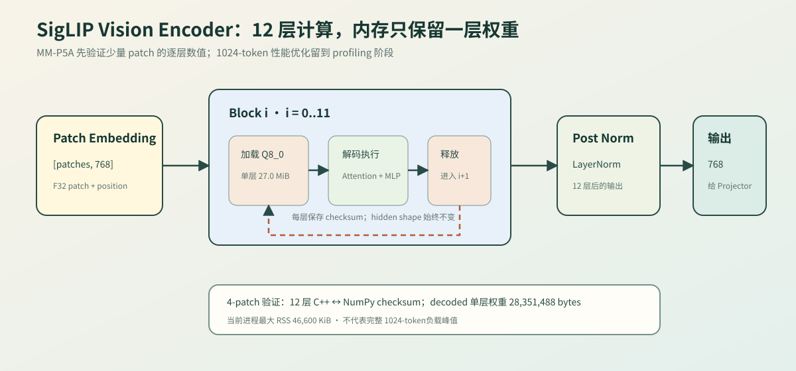

# mmproj 与视觉编码器

mmproj 是独立于语言模型 GGUF 的视觉权重文件。通用 GGUF Reader 先解析元数据和 Tensor 索引，多模态 Schema 再把这些字段转换为 IDEFICS3 配置、视觉层布局和 Projector 布局。

## 从文件索引到视觉模型

| 阶段 | 主要检查 | 产生的对象 |
| --- | --- | --- |
| GGUF 索引 | magic、版本、metadata、Tensor descriptor | 文件结构和数据偏移 |
| 视觉配置 | 图片、Patch、隐藏宽度、头数、层数 | `VisionModelConfig` |
| Tensor 布局 | 名称唯一性、shape、数据类型 | Patch、Block、Post Norm 和 Projector 映射 |
| 权重载荷 | offset、元素数、量化块边界 | 可执行的 F32 或 Q8_0 权重视图 |

Schema 把外部文件格式与执行对象隔开。Reader 不解释 SigLIP 数学，视觉编码器也不直接解析 GGUF 字段；新增文件格式或权重布局时，两侧通过配置与权重视图交接。


## SigLIP 编码块

Patch/Position Embedding 先把每个 Patch 映射到视觉隐藏宽度并加入位置。SigLIP Block 随后执行标准 LayerNorm、双向多头注意力、GELU 前馈网络和两次残差。

| 顺序 | 输入到输出 | 验证重点 |
| --- | --- | --- |
| Patch + Position | `[tokens, patch_values] -> [tokens, hidden]` | Linear 权重方向与位置行 |
| LayerNorm 1 | hidden -> normalized hidden | epsilon、gamma、beta |
| 双向全注意力 | Q/K/V -> context -> output projection | 多头切分、缩放和稳定 Softmax |
| Residual 1 | input + attention output | shape 与位置保持不变 |
| LayerNorm 2 + MLP | hidden -> intermediate -> hidden | GELU 与两层 Linear |
| Residual 2 | residual 1 + MLP output | 编码块最终输出 |

视觉注意力允许一个 tile 内的每个 Patch 读取全部位置，因此不使用语言 Decoder 的因果遮罩。CPU 和 CUDA 后端共享相同输入输出，CUDA 路径通过 `causal=false` 复用公共注意力执行接口。


## 为什么逐层加载

教学 CPU 路径把 Q8_0 权重解码为 Float32 参考值。若同时展开全部视觉层，会长期持有大量临时权重；weight provider 因此按层执行：

```text
加载第 i 层权重 -> 执行 Block -> 保留 hidden states -> 释放该层权重
```

CUDA 路径保留量化载荷并由融合 GEMV 解码，同时使用两个隐藏状态缓冲区交替承接层输出，跨层复用工作区。两种路径的资源策略不同，但逐层 shape、最终 Post Norm 和输出语义一致。



CPU、NumPy 与 CUDA 的固定误差、checksum 和资源结果统一查 [VAL-MM-01、VAL-MM-02 与 VAL-MM-CUDA-03～07](../../reference/experiment_assets.md#多模态cuda-与正确性资产)。其中完整 CUDA tile 执行 1024 个 Patch，并由 Projector 输出 64 行语言宽度向量。下一步进入[投影层与运行时交接](./03_runtime_handoff.md)。
