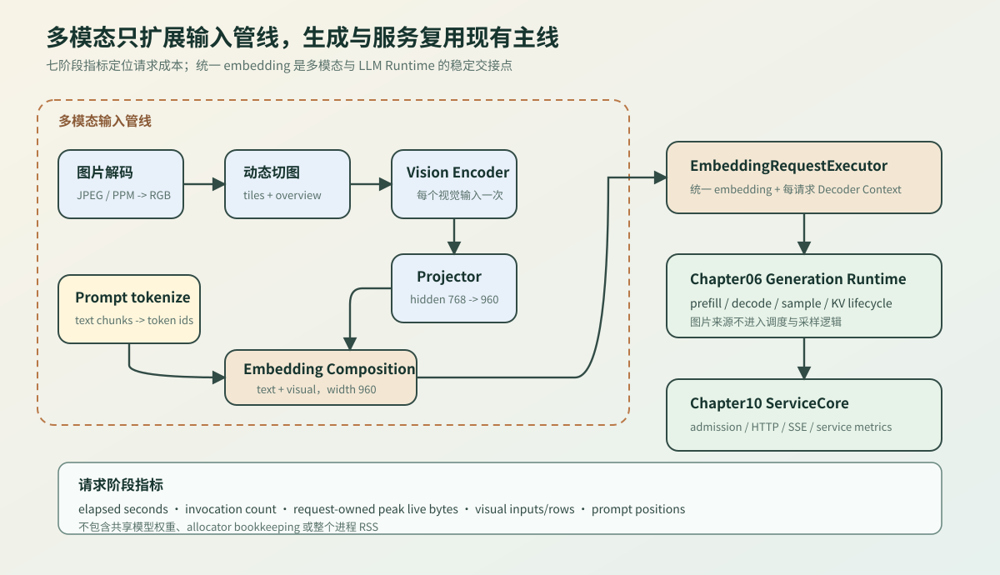

# 投影层与运行时交接

Vision Encoder 输出仍按 Patch 保存。IDEFICS3 Projector 先合并空间相邻的隐藏状态，再映射到语言模型隐藏宽度；组装器随后用视觉向量替换文本序列中的图片占位位置。

空间合并与 Projector 的矩阵 shape 见 [`F-MM-04`](../../reference/formulas.md#f-mm-04)，文本与视觉嵌入的拼接关系见 [`F-MM-03`](../../reference/formulas.md#f-mm-03)。

## 空间合并与宽度映射

每边合并 4 个 Patch 时，一个 Projector 输入由 `4×4` 个视觉隐藏状态拼成。隐藏宽度为 768 时，合并向量宽度为 `16×768=12288`；Linear 再把它映射到语言模型宽度 960。

```text
[1024, 768] Vision Encoder output
  -> [64, 12288] spatial merge
  -> [64, 960] Projector output
```

拼接顺序固定为 `dy -> dx -> hidden`。这个约定决定权重读取和视觉位置，不能把空间窗口当作任意 16 行进行拼接。


## 组成统一嵌入序列

Prompt 解析产生文本片段和图片片段。文本词元经过 Token Embedding，图片经过 Vision Encoder 和 Projector；两者宽度相同后，组装器在图片占位位置展开一行或多行视觉嵌入。

输出来源映射记录每一行来自文本位置还是视觉输入，用于检查多图片顺序和定位错误。语言 Decoder 只接收连续的 `[positions, hidden]`，后续计算不需要区分某行最初来自词元还是图片。


## 进入生成运行时

`EmbeddingRequestExecutor` 持有统一嵌入和独立 Decoder Context，并实现 Chapter06 的 `RequestModelExecutor`。Prefill 消费整段嵌入，后续 Decode 消费上一步生成词元。

| 交接点 | 输入 | 输出 | 所有者 |
| --- | --- | --- | --- |
| 图片管线 | 图片、Prompt、模型配置 | 文本/视觉嵌入 | 多模态输入处理器 |
| 引擎适配 | 统一嵌入、Decoder Context | `RequestModelExecutor` | 单个请求 |
| Chapter06 Runtime | Executor、生成配置 | 生成词元与请求终态 | Runtime / Request |
| Chapter07–08 | 语言 Context 和请求状态 | K/V 资源与执行计划 | Cache / Scheduler |
| Chapter10 ServiceCore | 服务请求、Executor Factory | 同步结果或 SSE 事件 | 服务核心 |



## 服务与性能边界

阶段指标分别记录图片解码、动态切图、Prompt 分词、Vision Encoder、Projector、嵌入组装和语言 Prefill。共享模型权重、请求中间量与进程 RSS 使用不同口径，比较前需要固定工作负载和统计范围。

图片上传协议属于 Transport 设计。多模态输入层先把图片与 Prompt 转换为 Executor，Chapter10 再管理准入、同步/流式输出、断连和资源释放；multipart、base64、大小限制和图片缓存可以在不改变 Runtime 契约的前提下扩展。

图文嵌入、32 层 Decoder、真实 Prompt、动态切图服务和 CUDA Context 的固定结果统一查[多模态验证资产](../../reference/experiment_assets.md#多模态cuda-与正确性资产)。CUDA 路径已把 6 个前缀文本词元、64 行视觉向量和 18 个后缀文本词元组成 `88x960` 序列，并复用 Chapter06 Runtime 完成四词元 CPU/CUDA 贪心生成对照。首个词元来自 Prefill logits，后续三个词元由逐词元 Decode 推进，因此四词元生成只增加三次 Context Decode。

服务验收让 Executor Factory 为同步与 SSE 请求分别创建 CUDA Context。两个请求生成相同四词元并独立释放，说明 Chapter10 无需识别视觉向量即可管理多模态终态。这仍是顺序服务检查；图片 HTTP 传输、视觉请求组批和语言模型批执行是后续交接点。继续阅读 [Python 与生产框架对照](./04_framework_comparison.md)，再按[多模态六任务学习计划](../../guides/multimodal_learning_plan.md)运行验证。
