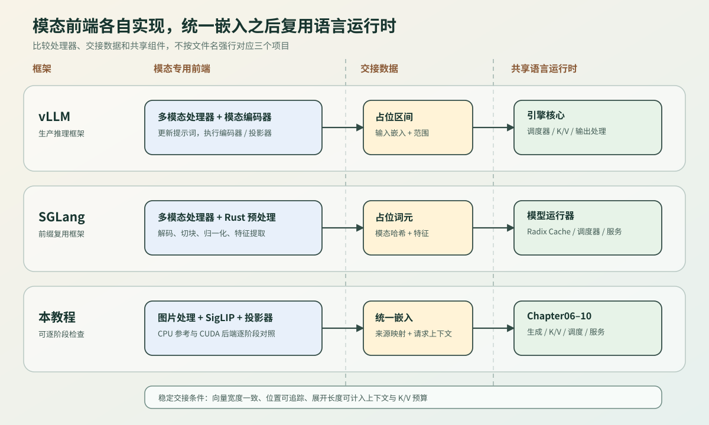
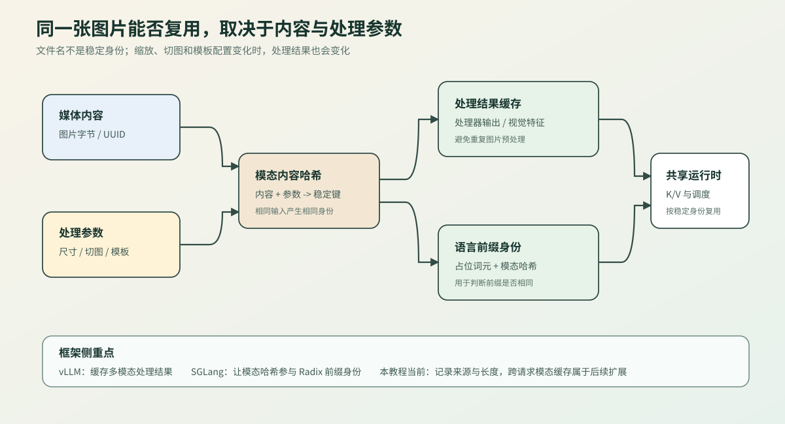

# Python 与生产框架对照

多模态框架通常把图片、音频或视频处理放在语言模型之前。模态处理器（Processor）生成与语言模型隐藏宽度一致的向量，并记录这些向量应替换提示词中的哪些位置。完成替换后，语言解码器、K/V Cache、调度器和服务层继续处理统一序列。

```text
模态输入 -> 模态处理器 -> 模态编码器 -> 视觉投影器 --+
                                                    +-> 统一嵌入 -> 语言解码器 -> K/V -> 调度器 -> 服务
文本输入 -> 分词器 -> 词元嵌入 ----------------------+
```

例如提示词中有一个图片标记，投影器生成 256 行视觉向量。处理器用这 256 行向量替换标记，并把展开后的序列长度交给 K/V 容量计算。图片解码和视觉编码留在模态前端，生成状态、缓存所有权和批处理进入共享运行时。



## Python 参考用于数值核对

[Hugging Face Transformers 的处理器（Processor）](https://huggingface.co/docs/transformers/en/processors)把聊天模板、分词和图片等输入转换成模型需要的张量。教程的 Python/NumPy 参考进一步固定单个 SigLIP Block、视觉投影器和嵌入组装的数值结果，用来检查公式、形状与遍历顺序。

Python 参考提供数值正确性基线。C++ 内存所有权由组件测试验证，CUDA 资源复用由设备测试验证，服务并发由集成测试验证。

## 流行框架怎样划分职责

| 框架 | 模态专用部分 | 与文本路径的交接 | 交接后复用 |
| --- | --- | --- | --- |
| Transformers | 处理器、模态编码器、视觉投影器 | 处理器产出文本与模态张量，模型按聊天模板和占位符组成输入 | 模型 `generate()` 与通用生成配置 |
| vLLM | `BaseMultiModalProcessor`、模态编码器（Tower）与视觉投影器 | 处理器计算占位区间；模型把编码器输出并入输入嵌入 | 引擎核心、K/V Cache、调度器、输出处理 |
| SGLang | `BaseMultimodalProcessor`、图片特征提取；可选 Rust 预处理 | `pad_input_ids` 固定占位词元和模态哈希，模型返回图片特征 | Radix Cache、调度器、模型运行器、服务入口 |
| llama.cpp | `libmtmd`、模态模型与 `mmproj` | `libmtmd` 编码媒体并把嵌入交给 `libllama` | `llama_context`、采样与服务端 |
| 本教程 | `code/multimodal` 的图片处理、SigLIP、视觉投影器与组装器 | `EmbeddingRequestExecutor` 接收 `[positions, hidden]` 和独立解码器上下文 | Chapter06–10 的生成运行时、K/V、调度器与服务核心 |

vLLM 的[多模态处理设计](https://docs.vllm.ai/en/latest/design/mm_processing/)把提示词更新、占位区间和处理结果缓存集中在处理器层；模型适配通过 [`SupportsMultiModal`](https://github.com/vllm-project/vllm/blob/main/docs/contributing/model/multimodal.md)声明语言模型、模态编码器以及嵌入合并方式。模型执行随后进入同一个引擎和调度循环。

SGLang 的[新模型接入说明](https://github.com/sgl-project/sglang/blob/main/docs/docs/supported-models/support_new_models.mdx)要求多模态处理器生成占位词元和内容哈希，使 Radix 前缀缓存可以识别相同输入；[`sglang-mm`](https://github.com/sgl-project/sglang/blob/main/rust/sglang-mm/README.md)把解码、缩放、切块、归一化和哈希等预处理下沉到 Rust，Python 处理器与服务入口继续使用统一接口。

llama.cpp 的 [`libmtmd`](https://github.com/ggml-org/llama.cpp/blob/master/tools/mtmd/README.md)把多模态组件作为独立子系统：语言模型 GGUF 与 `mmproj` 分开加载，图片或音频编码完成后再把嵌入送入 `libllama`。本教程采用相同的“模态前端与语言运行时分离”原则，同时保留逐阶段 CPU/CUDA 对照。



## 哪些信息仍要进入共享运行时

统一嵌入并不等于丢弃全部模态信息。下面几类元数据会影响缓存和调度：

| 信息 | 进入共享层的原因 |
| --- | --- |
| 占位区间与来源映射 | 检查视觉向量替换位置和多图片顺序 |
| 模态内容哈希 | 判断处理结果或前缀缓存能否复用 |
| 展开后的词元数量 | 计算上下文长度、K/V 容量和批次预算 |
| 编码器与投影器耗时 | 区分图片阶段、预填充和逐词元解码性能 |
| 图片尺寸与数量限制 | 在传输层和准入层控制请求资源 |

这些字段通过请求元数据进入共享层，模态编码器的权重、临时张量和计算图仍由多模态模块持有。新增音频或视频输入时，可以增加相应的处理器、编码器和投影器，并继续使用生成运行时。

## 对照阅读方法

1. 先用 Transformers 或 NumPy 核对输入张量、占位位置和阶段输出。
2. 再读 vLLM 与 SGLang，观察模态哈希、缓存和调度怎样连接。
3. 对照 llama.cpp，理解独立模态库与语言运行时的 C/C++ 边界。
4. 回到本教程的 `code/multimodal/README.md`，沿 `EmbeddingRequestExecutor` 进入 Chapter06–10。

本教程用 Transformers 核对模型输入，用 llama.cpp 核对真实外部结果，用 vLLM 与 SGLang 核对生产框架中的对象职责。教程运行时继续由仓库内的 C++ 组件组成。
