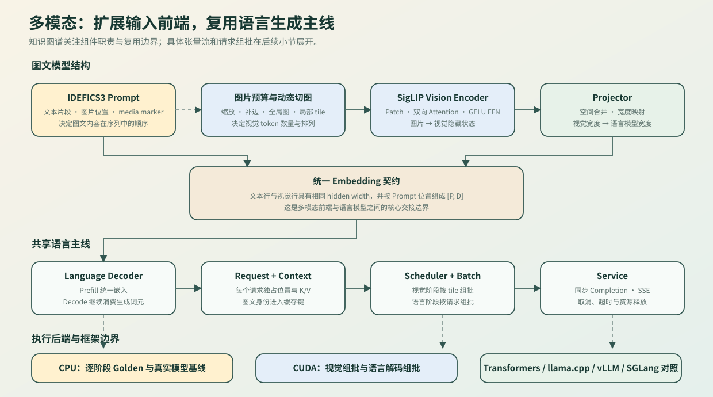
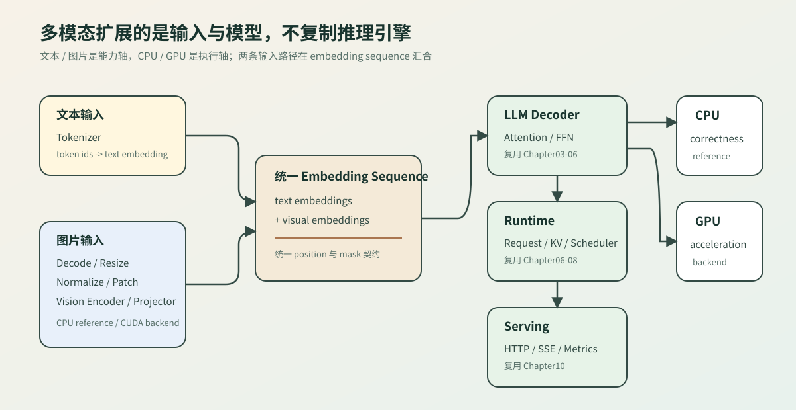

# 多模态扩展教程

多模态推理在文本路径前增加图片处理：图片先变成视觉嵌入，再与文本嵌入组成统一序列。序列进入语言 Decoder 后，生成、K/V、调度和服务继续使用 Chapter06–10 的对象。

```text
图片 -> 解码与动态切图 -> Vision Encoder -> Projector --+
                                                        +-> 统一嵌入 -> LLM Decoder -> Runtime
文本 -> Tokenizer -> Token Embedding -------------------+
```

先区分四个对象：

| 对象 | 在本教程中的含义 |
| --- | --- |
| IDEFICS3 | SmolVLM 使用的图文模型结构，规定图片切分、视觉编码、投影和提示词中的图片位置 |
| SigLIP 视觉编码器 | 把图片 Patch 转换为视觉隐藏状态的 Transformer；它使用双向全注意力 |
| 视觉投影器（Projector） | 合并相邻 Patch，并把视觉隐藏宽度映射到语言模型隐藏宽度 |
| 统一嵌入 | 按提示词顺序排列的文本向量和视觉向量，是多模态前端交给语言解码器的数据 |

下图展示视觉前端、统一嵌入契约和共享语言主线的关系。它用于定位组件职责；逐步张量流在后续页面展开。



## 为什么选择 SmolVLM

教程使用 SmolVLM 500M Instruct 的 IDEFICS3 图片路径。模型规模适合在单机 CPU 上逐阶段检查，同时覆盖动态切图、SigLIP 视觉编码器、空间合并投影器和语言模型解码器。

| 选择条件 | 教学价值 |
| --- | --- |
| 单机可执行 | CPU 可以逐阶段建立正确性基线，CUDA 作为后端扩展 |
| 输入阶段完整 | 同时观察缩放、补边、全局图、局部切片、Patch 和视觉词元 |
| 运行时可复用 | Projector 输出与语言模型隐藏宽度一致，可以组成统一嵌入序列 |
| 量化可解释 | Q8_0 提供规则明确的视觉权重解码与线性层对照 |
| 外部可对照 | Transformers 核对模型输入，llama.cpp 核对真实结果，vLLM 与 SGLang 核对生产运行时结构 |

固定 JPEG 验证真实图片从解码到文本生成的完整过程，无损 PPM 与合成张量用于局部精确回归。模型质量评测另行定义样本、标注和指标。

## 与主线共享什么

| 主线对象 | 多模态怎样复用 |
| --- | --- |
| GGUF Reader、Tensor | 读取 mmproj 索引，表达图片、Patch 和视觉隐藏状态 |
| Linear、Attention、Norm、FFN | 组成 SigLIP 编码块和 Projector |
| 量化 Linear | 执行 Q8_0 视觉权重 |
| Request、Executor、Runtime | 接收统一嵌入并推进预填充和逐词元解码 |
| K/V、Scheduler | 管理语言 Decoder 的历史状态和多请求计划 |
| ServiceCore、ResponseWriter | 管理同步/流式输出和终态释放 |



## 阅读顺序

1. [图片预算与动态切图](./01_image_preprocessing.md)：图片如何变成顺序确定的 Patch 输入。
2. [mmproj 与视觉编码器](./02_vision_encoder.md)：视觉配置、权重和 SigLIP Block 如何执行。
3. [投影层与运行时交接](./03_runtime_handoff.md)：视觉词元如何进入语言模型、生成运行时和服务。
4. [Python 与生产框架对照](./04_framework_comparison.md)：Transformers、vLLM、SGLang 和 llama.cpp 怎样划分模态前端与共享运行时。

执行顺序和命令回到[多模态六任务学习计划](../../guides/multimodal_learning_plan.md)，已实现入口查[模型支持表](../../reference/model_support.md)，固定结果查[实验资产索引](../../reference/experiment_assets.md#多模态cuda-与正确性资产)。
