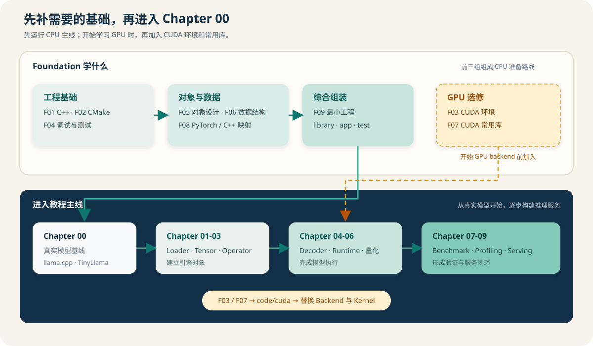

# Foundation 基础准备

## 本节导读

Foundation 帮助你解决进入推理引擎代码前最常见的三个问题：怎样构建和测试 C++ 项目，怎样理解对象与 Tensor 的数据关系，以及怎样把 library、app 和 test 组装成一个小工程。

如果这些内容已经熟悉，直接进入 [`Chapter 00`](../chapter00_quickstart/intro.md)运行 TinyLlama；如果其中一项还不熟，从下图左侧选择对应内容。第一次学习 C++ 工程时，按“工程基础 → 对象与数据 → 综合组装”阅读，准备学习 GPU 时再加入 CUDA 选修。

## 开始学习

读完所选页面后，打开[正文与练习映射](./exercise_map.md)，从 [`Foundation 题库`](../exercises/foundation/README.md)选择一到两道题，修改 starter 并运行测试。

| 你现在需要 | 阅读页面 | 读完去做什么 |
| --- | --- | --- |
| 构建、运行和调试 C++ 程序 | [F01 C++](./01_cxx_basics.md)、[F02 CMake](./02_cmake_build_basics.md)、[F04 调试测试](./04_debugging_testing_basics.md) | 进入 Chapter 00，构建并运行真实模型基线 |
| 理解所有权、Tensor、view 和数据布局 | [F05 对象设计](./05_oop_and_design_basics.md)、[F06 数据结构](./06_data_structure_algorithm_basics.md)、[F08 概念映射](./08_pytorch_to_cpp_bridge.md) | 阅读 Chapter 01-03 的 Loader、Tensor 与 Operator |
| 亲手组装一个可测试的小工程 | [F09 最小项目](./09_minimal_cpp_cuda_project.md) | 构建 demo，并用 CTest 验证 library 和资源对象 |
| 编译 CUDA 并认识常用 GPU 库 | [F03 CUDA 环境](./03_cuda_environment_basics.md)、[F07 CUDA 库](./07_cuda_common_libraries.md) | 运行 `code/cuda`，再学习 CUDA backend 与性能实验 |
