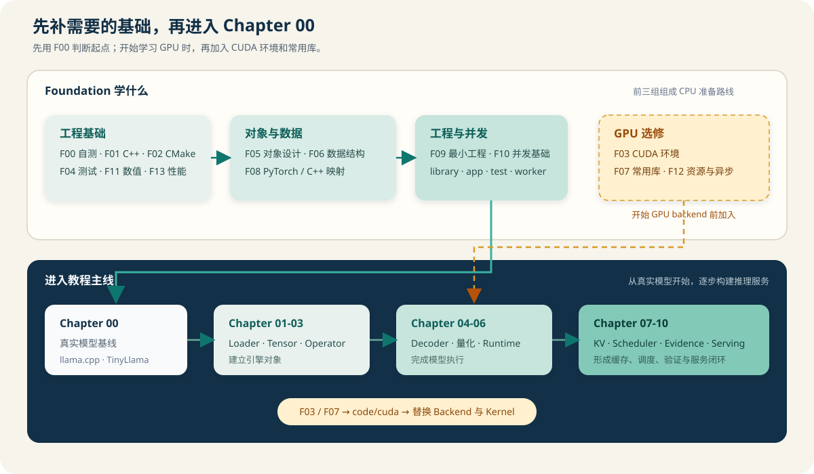
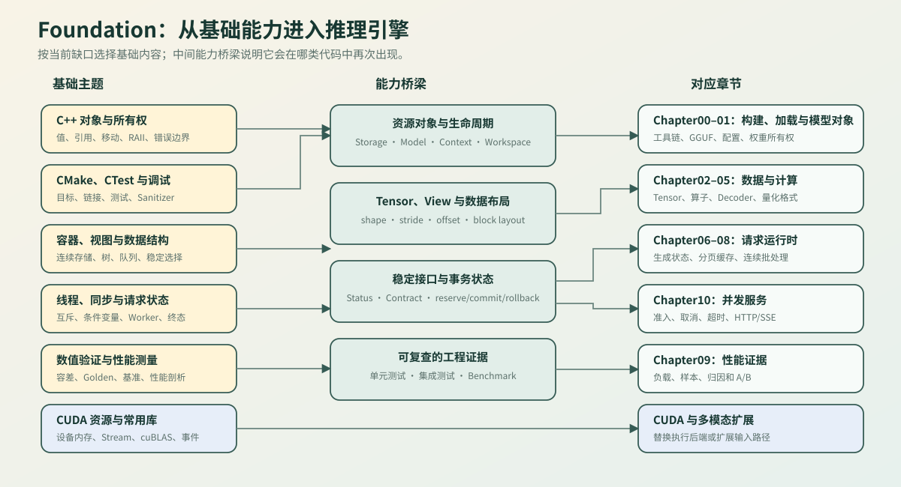

# Foundation 基础准备

## 本节导读

Foundation 帮助你补齐阅读推理引擎代码所需的基础：构建和测试 C++ 项目，理解对象与张量的数据关系，组织资源与并发状态，以及验证数值和性能结论。GPU 选修进一步介绍 CUDA 环境、资源生命周期和常用库。

如果这些内容已经熟悉，可以直接进入 [`Chapter 00`](../chapter00_quickstart/intro.md)运行 TinyLlama。C++ 基础较弱时，先完成 [F00 C++ 就绪自测](./00_cpp_readiness.md)，再按“数据处理 → 构建与所有权 → 运行时状态”逐步练习；准备学习 GPU 时加入 CUDA 选修。



下图把基础主题连接到教程中的工程对象与章节。阅读主线时遇到所有权、数据布局、请求状态或性能测量问题，可以沿图返回对应基础页面。



## 开始学习

先根据当前缺口选择一组正文，可以按需跳过已经掌握的主题。读完所选页面后，打开[正文与练习映射](./exercise_map.md)，选择一到两道起步练习；先运行自己的答案，再运行题库参考回归。

| 你现在需要 | 阅读页面 | 读完去做什么 |
| --- | --- | --- |
| 判断是否具备题库所需语法 | [F00 C++ 就绪自测](./00_cpp_readiness.md) | 选择弱基础路线或直接进入 F01 |
| 构建、运行和调试 C++ 程序 | [F01 C++](./01_cxx_basics.md)、[F02 CMake](./02_cmake_build_basics.md)、[F04 调试测试](./04_debugging_testing_basics.md) | 进入 Chapter 00，构建并运行真实模型基线 |
| 理解所有权、Tensor、稳定选择、前缀树和数据布局 | [F05 对象设计](./05_oop_and_design_basics.md)、[F06 数据结构](./06_data_structure_algorithm_basics.md)、[F08 概念映射](./08_pytorch_to_cpp_bridge.md) | 阅读 Chapter01–04、Chapter07 与多模态输入路径 |
| 亲手组装一个可测试的小工程 | [F09 最小项目](./09_minimal_cpp_cuda_project.md) | 构建 demo，并用 CTest 验证 library 和资源对象 |
| 理解请求并发、Worker 和异步完成 | [F10 并发基础](./10_concurrency_basics.md) | 阅读 Chapter08 调度与 Chapter10 服务并发 |
| 比较 CPU、CUDA 或量化结果 | [F11 数值验证](./11_numerical_validation.md) | 阅读 Chapter03–05 的 Golden、误差与模型决策证据 |
| 建立可复查的性能结论 | [F13 性能测量](./13_performance_measurement.md) | 阅读 Chapter09 的 Benchmark、Profiler 和 A/B 实验 |
| 编译 CUDA 并理解设备资源 | [F03 CUDA 环境](./03_cuda_environment_basics.md)、[F07 CUDA 库](./07_cuda_common_libraries.md)、[F12 CUDA 资源](./12_cuda_resource_lifecycle.md) | 运行 `code/cuda`，再学习 CUDA 后端与性能实验 |

## 弱基础学习路线

这条路线先练数据处理，再加入资源所有权、工程组织和运行时状态。题号对应的内容可在[正文与练习映射](./exercise_map.md)中查找：

```text
F00
  -> FQ02 -> FQ05 -> FQ07
  -> FQ04 -> FQ01 -> FQ03 -> FQ08 -> FQ12
  -> FQ06 -> FQ18 -> FQ17
  -> FQ09 -> FQ11 -> FQ13 -> FQ14 -> FQ15 -> FQ16 -> FQ19
  -> FQ22 -> FQ21
```

完成 `FQ02`、`FQ05`、`FQ07` 后已经可以进入 Chapter00 建立真实模型印象；后续题目按所读章节逐步补齐。`FQ10` 和 `FQ20` 属于 GPU 选修。

## 验证与下一步

| 验收范围 | 执行入口 | 通过条件 |
| --- | --- | --- |
| 参考实现 | `bash exercises/foundation/run_all.sh` | 题库 CTest 全部通过 |
| 所选练习 | 单题 README 中的答案命令 | 自己完成的起步代码满足输出、错误路径和资源约定 |
| CUDA 选修 | `CUDA_HOME=... bash code/cuda/scripts/run.sh` | CPU golden 与设备结果在容差内一致 |

能独立构建一道练习、说明资源所有权并读懂 CTest 失败后，就可以进入 [`Chapter 00`](../chapter00_quickstart/intro.md)建立真实模型基线。CUDA 选修可以在开始 GPU 路线前补充。
