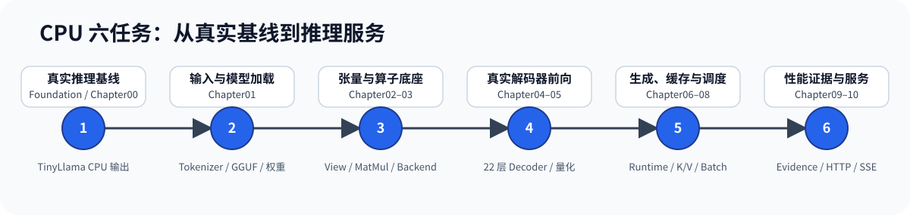

# CPU 六任务学习计划

这组任务用于完成一条可运行、可解释、可验证的 CPU 学习路径。六个任务从真实推理基线开始，经过输入、张量、算子、解码器和生成运行时，最终组成最小推理服务。

任务按可验证产物组织正文、代码和练习，每项任务对应一份可保存的学习记录。

每项任务指定一个主阅读入口和一条主验证命令；其他命令用于拆解和排错。每次结果按任务前的共通验收记录保存，记录 Git commit、环境、输入、关键输出和适用范围。

## 总体顺序

每个任务按需领取 Foundation 中的 C++、CMake、数据结构和调试练习；C++ 基础较弱时先完成 [`F00 C++ 就绪自测`](../foundation/00_cpp_readiness.md)，再按 Foundation 导读中的弱基础路线进入题库。

| 顺序 | 任务 | 主要章节 | 完成后的可验证产物 | 运行条件 |
| --- | --- | --- | --- | --- |
| 1 | 建立真实 CPU 推理基线 | Foundation、Chapter00 | TinyLlama GGUF 能由 llama.cpp 在 CPU 上生成文本 | C++ 工具链、llama.cpp 和 GGUF |
| 2 | 打通输入、分词器与模型加载 | Chapter01 | 能检查 GGUF、真实分词器、模型结构和权重映射 | 轻量测试只需 CPU；真实验证需要 GGUF |
| 3 | 建立张量、视图、算子与矩阵乘法底座 | Chapter02、Chapter03 | 共享存储的视图与正确的 CPU 矩阵乘法后端 | C++ 工具链 |
| 4 | 完成真实解码器 CPU 前向 | Chapter04、Chapter05、`code/engine` | TinyLlama 22 层预填充/解码与 llama.cpp 基准结果对齐 | GGUF；AVX2 实验需要 CPU 支持 |
| 5 | 完成生成、K/V 与调度链 | Chapter06、Chapter07、Chapter08 | 单请求生成、分页 K/V、chunked prefill 和多请求批次可运行 | 组件路径只需 CPU；真实验收需要 GGUF |
| 6 | 完成性能证据与最小 CPU 服务 | Chapter09、Chapter10 | 可比较的性能结果，以及 HTTP、SSE 和指标验证 | CPU；真实模型路径需要 GGUF，AVX2 为可选实验 |

六项任务以标量（scalar）路径为共同基线，AVX2 是 x86_64 上的选做性能实验。Linux 或 WSL2 可用 `lscpu | grep -i -E 'avx2|fma'` 检查指令集；输出同时包含 `avx2` 和 `fma` 时再运行对应实验。

仓库发布验收覆盖 x86_64 Linux。ARM64 构建使用标量路径，适合检查通用代码的可移植性；把 ARM64 作为完整运行平台前，还需要补充持续集成、真实模型和 NEON/SVE 性能证据。

## 首轮与进阶范围

首轮只读形成当前任务产物所需的页面；框架对照、硬件优化和服务策略留到产物跑通后。编号对应各章正文编号，具体入口仍从章节导读进入。

| 章节 | 首轮必读 | 第二轮进阶 / 按需选读 |
| --- | --- | --- |
| Chapter00 | 00.1-00.4 环境、构建、模型、首次推理 | 00.5 排错按需 |
| Chapter01 | 01.1、01.3-01.5 张量、加载器、分词器、GGUF | 01.2 教学格式；01.6 框架对照 |
| Chapter02 | 02.1-02.4 存储、变形、切片、测试 | 02.5 框架张量/视图对照 |
| Chapter03 | 03.1-03.3 算子、矩阵乘法、CPU 参考实现 | 03.5-03.7 数值、复杂度和真实后端；03.4 cuBLAS 留到 GPU 阶段 |
| Chapter04 | 04.1-04.6 注意力、归一化/前馈网络、解码器、首层接线和真实 TinyLlama | 04.7 成熟框架对照 |
| Chapter05 | 05.1、05.4-05.6 原理、反量化、线性层、精度 | 05.2-05.3 数据类型/加载器深入；05.7-05.8 框架与服务对照 |
| Chapter06 | 06.1-06.8 请求、预填充/逐词元解码、生成循环和真实单请求 | 06.9 框架生成核心对照 |
| Chapter07 | 07.1-07.5 连续基线、分页映射、事务、注意力和真实模型迁移 | 07.6 前缀复用与成熟框架扩展 |
| Chapter08 | 08.1-08.4 调度规则、连续批处理、分块预填充和真实批量执行 | 08.5-08.6 重叠调度与框架对照 |
| Chapter09 | 09.1-09.4 正确性、工作负载、样本与统计 | 09.5-09.9 工具、热点、A/B 和框架对照 |
| Chapter10 | 10.1-10.5 生命周期、准入、释放和同步响应 | 10.6-10.10 SSE、并发、指标、真实模型和框架对照 |

## 模型学习范围

首轮六任务固定 TinyLlama，使加载器、解码器、生成运行时和服务使用同一份小模型资产。完成首轮后，再按架构差异选择一条第二轮路径：

| 第二轮模型 | 重点观察 | 对应任务 |
| --- | --- | --- |
| Qwen3-0.6B | Q/K 归一化、NeoX RoPE、共享 LM Head 和第二种稠密配置 | 任务 2、4、5、6 |
| Qwen1.5-MoE | 路由器、Top-K、共享专家和跨请求专家分组 | 任务 2、4、5、6 |
| DeepSeek-V2-Lite | MLA、混合稠密/MoE 层和压缩 K/V | 任务 2、4、5、6 |

模型状态、固定资产和真实入口统一查看[模型能力与扩展顺序](../reference/model_support.md)。第二轮用于理解模型架构怎样改变加载器、解码器和执行策略，六任务的系统顺序保持一致。

## 共通验收记录

每完成一项任务，保存一份可复查记录。文件可以保存在个人学习目录，建议名称包含日期和主题，例如 `2026-10-19-real-decoder.md`。

| 类别 | 需要记录的内容 |
| --- | --- |
| 环境 | 日期、Git commit、操作系统、CPU 型号、线程数、编译器和 CMake |
| 输入 | 学习主题、模型文件、量化格式和主阅读入口 |
| 执行 | 主命令、退出状态和关键输出 |
| 证据 | 正确性、容差、性能数据及单位 |
| 解释 | 数据流、基线、本次结果能证明什么、失败时先检查什么 |
| 下一次学习 | 选择一条可选路径、一个待理解问题或一项单一变化 |

记录不需要粘贴完整构建日志，但应保留能够复现结果的环境、输入和命令。

## 任务 1：建立真实 CPU 推理基线

本任务固定后续自研引擎对照的模型、分词器、提示词和输出。先按需完成 Foundation 入门组，再运行 Chapter00 的仓库冒烟检查，最后使用 llama.cpp 运行 TinyLlama。

已熟悉 C++ 类和所有权时，建议先做 `FQ01`、`FQ02`、`FQ04`、`FQ05`；基础较弱时按 `F00 -> FQ02 -> FQ05 -> FQ07 -> FQ04` 进入。所有权和最小工程仍不熟时，再做 `FQ01`、`FQ12`、`FQ17`。主线阅读顺序是 [`Foundation 导读`](../foundation/intro.md)、[`Chapter00 导读`](../chapter00_quickstart/intro.md)、环境、构建、模型下载和第一次推理。

| 任务卡 | 内容 |
| --- | --- |
| 主阅读入口 | [`Chapter00 导读`](../chapter00_quickstart/intro.md) |
| 主验证命令 | `llama.cpp/build/bin/llama-simple -m llama.cpp/models/tinyllama-1.1b-chat-v1.0.Q4_K_M.gguf -p "Hello TinyLlama" -n 16` |
| 学习记录 | `cpu-baseline.md`：模型、提示词、线程数和真实输出 |
| 基础练习 | Foundation 练习脚本通过，并能解释失败时先检查什么 |
| 仓库冒烟检查 | `bash code/chapter00_quickstart/run.sh` 编译并正常退出 |
| 真实推理 | llama.cpp 加载 GGUF，真实分词器处理提示词，并生成非空文本 |
| 记录验收 | 保存模型路径、提示词、线程数和一次真实输出；真实推理单独记录模型输出 |

## 任务 2：打通输入、分词器与模型加载

本任务处理“外部资产怎样变成稳定的程序对象”，先确认词元编号、模型元数据、张量索引、形状、数据类型和权重载荷能被可靠读取。完整解码器数学从 Chapter04 开始。

阅读 [`Chapter01 导读`](../chapter01_tensor_loader/intro.md)，按“输入要求与分词器 → GGUF 元数据 → 张量索引/载荷 → `ModelConfig`/`ModelBuilder`”推进。练习选择 `FQ02`、`FQ08` 和 `FQ17`。

| 任务卡 | 内容 |
| --- | --- |
| 主阅读入口 | [`Chapter01 导读`](../chapter01_tensor_loader/intro.md) |
| 主验证命令 | `CPP_LLM_ENGINE_MODEL_PATH=... bash code/chapter01_tensor_loader/run_real_tokenizer.sh` |
| 学习记录 | `input-and-loader.md`：词元编号、元数据、模型结构约束和权重映射 |
| 轻量测试 | Chapter01 默认测试通过 |
| GGUF 检查 | `gguf_inspect --validate-schema` 输出合法元数据、张量索引和载荷偏移 |
| 分词器 | 同一提示词的词元编号落在词表范围内，并能说明教学实现与真实实现的差异 |
| 模型构建 | 能从张量名称追踪到层映射，并区分共享模型与请求执行上下文 |

## 任务 3：建立张量、视图、算子与矩阵乘法底座

先完成张量的所有权和视图语义，再进入算子与后端。学习重点是同一块底层存储如何被不同形状、步长和偏移解释，以及上层算子如何在数学语义不变的前提下替换执行后端。

阅读 [`Chapter02 导读`](../chapter02_tensor_ops/intro.md) 和 [`Chapter03 导读`](../chapter03_matmul/intro.md)。练习按 `FQ03 → FQ06 → FQ08 → FQ12` 执行。

| 任务卡 | 内容 |
| --- | --- |
| 主阅读入口 | [`Chapter02 导读`](../chapter02_tensor_ops/intro.md)，随后进入 [`Chapter03`](../chapter03_matmul/intro.md) |
| 主验证命令 | `bash scripts/workflows/run_tensor_operator_learning.sh` |
| 学习记录 | `tensor-and-operator.md`：存储/视图约定、错误输入和矩阵乘法输出 |
| 张量视图 | 变形、切片、共享存储、步长、偏移和越界测试通过 |
| 公共接口 | 能说明 `TensorContract`、`Status`、`Operator` 和 `Backend` 的调用关系 |
| CPU 矩阵乘法 | 参考计算核数值正确，非法形状被明确拒绝 |
| 学习练习 | 完成视图、迷你张量、CPU 矩阵乘法和 RAII 工作区对应练习 |

## 任务 4：完成真实解码器 CPU 前向

先用 Chapter04 理解注意力（Attention）、残差和前馈网络（FFN）的结构，再用 Chapter05 理解 TinyLlama Q4_K/Q6_K 权重如何进入线性层，最后通过 `code/engine` 与 Chapter01 的真实模型和执行上下文运行 22 层解码器。教学解码器用 LayerNorm/ReLU 拆解结构，真实 TinyLlama 路径使用 RMSNorm、RoPE、GQA 和 SwiGLU，两者通过公共结构规则对照。本任务增加 `FQ18`，用最大误差、均方根误差（RMSE）、余弦相似度和贪心词元区分数值接近与行为一致。

| 任务卡 | 内容 |
| --- | --- |
| 主阅读入口 | [`Chapter04 导读`](../chapter04_attention/intro.md)，量化细节按需进入 [`Chapter05`](../chapter05_quantization/intro.md) |
| 主验证命令 | `CPP_LLM_ENGINE_MODEL_PATH=... bash scripts/workflows/run_real_decoder_learning.sh` |
| 学习记录 | `real-decoder.md`：结构约定、量化后端、基准词元和适用范围 |
| 解码器结构 | 因果注意力、前馈网络、残差和 `DecoderLayer` CPU 测试通过 |
| TinyLlama 数学 | 能在真实执行上下文中定位 RMSNorm、RoPE、GQA、SwiGLU、最终归一化和 LM Head |
| 量化线性层 | Q4_K/Q6_K 参考实现与融合路径通过正确性对照 |
| 真实等价性 | 经过 22 个解码器块后的最终候选分数、Top-K 和 4 词元贪心序列满足固定验收标准 |

## 任务 5：完成生成运行时

本任务把模型前向扩展为三段可独立验证的系统：Chapter06 负责单请求生成语义，Chapter07 负责连续与分页 K/V，Chapter08 负责多请求选择、分块预填充和批量执行。HTTP API 由任务 6 接入。

练习按 `FQ07 → FQ09 → FQ11 → FQ13 → FQ14 → FQ15 → FQ16 → FQ19 → FQ22` 执行。正文从 [`Chapter06 导读`](../chapter06_generation/next/intro.md)进入，再依次学习 [`Chapter07 K/V Cache`](../chapter07_kv_cache/next/intro.md)和 [`Chapter08 Scheduling`](../chapter08_scheduling/next/intro.md)。

| 任务卡 | 内容 |
| --- | --- |
| 主阅读入口 | [`Chapter06 导读`](../chapter06_generation/next/intro.md) |
| 主验证命令 | `CPP_LLM_ENGINE_MODEL_PATH=... bash scripts/workflows/run_generation_runtime_learning.sh` |
| 学习记录 | `generation-runtime.md`：状态迁移、调度步计划、分块和物理块回滚 |
| 单请求生成 | 预填充、逐词元解码、贪心采样、EOS 和词元预算测试通过 |
| 多请求状态 | 执行器、取消、超时、失败和资源状态相互隔离 |
| 分块预填充 | 中间分块只推进输入，最后分块产生候选分数，失败时游标和物理块正确回滚 |
| 调度与内存 | 能解释词元/物理块预算、块表、分页载荷、批次计划和终态释放 |

## 任务 6：完成最小 CPU 推理服务

先完成 `FQ21`，理解预热、反向执行顺序、原始样本和正确性门禁；再用 Chapter09 固定工作负载与 A/B 判断，并用 Chapter10 把请求接到准入、等待/运行、取消、超时和回收。网络库只承载传输协议，并通过稳定接口调用服务核心（`ServiceCore`）。

| 任务卡 | 内容 |
| --- | --- |
| 主阅读入口 | [`Chapter09 导读`](../chapter09_performance/next/intro.md)，随后进入 [`Chapter10`](../chapter10_serving/next/intro.md) |
| 主验证命令 | `CPP_LLM_ENGINE_MODEL_PATH=... bash scripts/workflows/run_cpu_service_learning.sh` |
| 学习记录 | `cpu-service.md`：请求数、词元预算、正确性、TTFT、吞吐和环境 |
| 服务核心 | 准入、等待/运行、调度步分发、取消、超时和统一释放测试通过 |
| HTTP/SSE 接口约定 | 同步响应、流式输出、错误映射和指标测试通过 |
| 真实 HTTP 连接 | 本地监听、同步基准结果、SSE 词元顺序与累计指标通过 `curl` 检查 |
| 真实模型服务 | 双请求基准结果、分块预填充、执行上下文隔离和物理块释放检查通过 |
| 性能基准/剖析 | 保存顺序与并发两份 JSON，完成正确性优先的单变量 A/B 并解释结论 |
