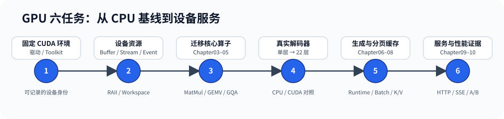

# GPU 六任务学习计划

GPU 路线在 CPU 已验证的算法和公共接口上替换设备内存、计算核与执行上下文。建议先完成 [CPU 六任务](./cpu_learning_plan.md)中的前四项；完整学习调度和服务前，再补齐 CPU 任务五、六。

TinyLlama 与 Qwen3 已形成完整稠密 GPU 基线：真实模型加载、完整 Decoder、Generation、分页 K/V、批量执行和服务均有验证入口。DeepSeek-V2-Lite 继续覆盖分页 MLA、权重吸收、MoE 专家执行、格式专用量化 GEMV 和设备 Router。三种模型复用同一 Runtime、调度与服务契约。

环境安装与故障排查见 [CUDA 安装与配置](./setup_cuda.md)，代码对象与测试清单见 [`code/cuda/README.md`](/code/cuda)。



## 总体顺序

| 顺序 | 任务 | 主要入口 | 完成后的可验证产物 |
| --- | --- | --- | --- |
| 1 | 固定 CUDA 环境 | Foundation CUDA、环境指南 | 驱动、Toolkit、编译器和 GPU 身份可记录 |
| 2 | 掌握设备资源与执行上下文 | `code/cuda` 资源层 | Buffer、Stream、Event、cuBLAS Handle 和 Workspace 生命周期正确 |
| 3 | 迁移核心算子 | Chapter03–05、`code/cuda` | MatMul、量化 Linear、RoPE 和 GQA 与 CPU 结果一致 |
| 4 | 运行真实 GPU Decoder | `code/model`、`code/engine` | TinyLlama 单层、2 层和 22 层结果通过 CPU/CUDA 对照 |
| 5 | 接入生成、批次与分页 K/V | Chapter06–08、`code/engine` | 真实生成、多请求批次和分页缓存正确推进 |
| 6 | 接入服务并建立性能证据 | Chapter09–10 | 同步/SSE 服务通过，GPU 优化有可重复的 A/B 证据 |

## 当前完成度与后续边界

六项教学任务均已有真实设备入口。TinyLlama 和 Qwen3 覆盖稠密模型纵向闭环；DeepSeek-V2-Lite 覆盖 27 层 MLA+MoE Runtime 与 Serving，并用 EXP-GPU-20～33 记录算法、计算核和数据搬运的逐步优化。

| 范围 | 当前状态 | 下一步 |
| --- | --- | --- |
| 资源与核心算子 | 已完成真实设备测试 | 继续保持跨 CUDA 版本回归 |
| 稠密模型 | TinyLlama、Qwen3 已完成 Runtime/Serving | 扩展模型需先通过 schema 与 CPU golden |
| DeepSeek MLA | 连续/分页、Tensor Prefill、权重吸收已完成 | 增加优化后热点复测 |
| DeepSeek MoE | 专家执行、packed dispatch、设备 Router 已完成；设备分组候选已验证但未带来稳定收益 | 默认保留 Host 建组；融合 grouped-MoE 进入性能扩展队列 |
| Attention 优化 | 三阶段 golden 与 FA2-inspired 候选可 A/B | 保留教学候选，收益通过端到端证据后再切默认 |
| 工程范围 | 单消费级 NVIDIA GPU | 多 GPU、分布式与生产级多租户作为框架对照 |

## CUDA 与多模态的近期交接

当前 CUDA 纵向教学任务已经完成，性能建设已按证据收敛到明确边界。EXP-GPU-32 确认设备 Router 消除了完整 hidden 回传；EXP-GPU-33 又验证设备分组候选的数值正确，但短序列回退、长序列基本持平，因此没有切换默认路径。CUDA 语言模型主线进入维护状态，新的实现重心转向视觉 CUDA；融合 grouped-MoE、更多 Attention 候选和多 GPU 继续留在性能扩展队列。

视觉 CUDA 已完成真实 mmproj Q8_0 的 Patch/Position Embedding、单个 SigLIP Block、12 层 Encoder、Projector 和一行视觉 embedding 到语言 Context 的对照。视觉三阶段在同一 CUDA Context 内复用持久工作区；视觉结果进入语言 Context 时仍经过 Host 中转。下一步扩展完整 1024-token tile、图文混合 Prefill 和设备直连，再接 Runtime 与服务。

## 任务 1：固定 CUDA 环境

先记录 GPU、驱动、CUDA Toolkit、编译器和 CMake，再运行最小设备访问检查。环境版本是后续数值和性能结果的一部分。

```bash
nvidia-smi
nvcc --version
cmake --version
c++ --version
```

完成标志是 `nvidia-smi` 与 `nvcc` 指向预期设备和 Toolkit，`CUDA_HOME` 能被 CMake 识别。安装问题只在环境指南处理，不进入算子代码排查。

## 任务 2：掌握设备资源与执行上下文

阅读 `DeviceBuffer`、`PinnedHostBuffer`、`CudaStream`、`CudaEvent`、`CublasHandle`、`CudaWorkspace` 和 `CudaExecutionContext`。重点追踪谁拥有资源、异步操作在哪个 Stream 上发生、失败后由谁释放。

```bash
CUDA_HOME=/usr/local/cuda-12.8 bash code/cuda/scripts/run.sh
```

先关注资源、异步拷贝、事件计时和移动语义测试。编译成功只证明工具链可用；设备执行、错误返回和释放测试同时通过后，资源层才算完成。

## 任务 3：迁移核心算子

按 `Vector Add → cuBLAS MatMul → Q4_K/Q6_K GEMV → RoPE → GQA Attention` 阅读。每条 CUDA 路径都与 CPU 参考结果比较，再观察工作区、内存访问和融合策略。

| 对象 | 原理入口 | GPU 实现重点 |
| --- | --- | --- |
| MatMul | Chapter03 | 行主序映射、cuBLAS Handle 与 Stream |
| 量化 Linear | Chapter05 | 分块解码、格式专用融合 GEMV 与批量权重复用 |
| RoPE、GQA、MLA | Chapter04 | 位置、Head 映射、因果遮罩、低秩缓存与权重吸收 |
| MoE Router | Chapter04 | 全专家 Softmax、稳定 Top-K、专家分发与设备路由 |

完成标志是 `code/cuda/scripts/run.sh` 中对应设备测试通过，并能解释 CPU 参考实现与 CUDA 计算核的输入输出为何相同。

## 任务 4：运行真实 GPU Decoder

核心算子通过后，把真实 TinyLlama 权重上传到 GPU，依次验证首层、短 Decoder 和完整 22 层。模型保存共享权重，Context 保存请求位置与 K/V，两者的生命周期继续沿用 CPU 接口和状态规则。

```bash
bash code/engine/scripts/run_real_cuda_first_layer.sh
bash code/engine/scripts/run_real_cuda_decoder.sh
```

完成标志是 CPU/CUDA hidden、分层 K/V 和最终输出落在规定容差内，两个请求 Context 互不污染。

## 任务 5：接入生成、批次与分页 K/V

真实 Decoder 进入 Chapter06 Runtime 后，继续验证预填充、逐词元解码、批量工作区和分页 K/V。Scheduler 负责选择请求，GPU Executor 负责执行张量批次；请求终态与资源事务仍由 Chapter07–08 管理。

```bash
bash code/engine/scripts/run_real_cuda_runtime.sh
bash code/engine/scripts/run_real_cuda_generation.sh
```

完成标志是固定提示词产生 CPU 同款词元序列，连续两步能够复用工作区，分页 K/V 在成功时提交、失败时回滚。

## 任务 6：接入服务并建立性能证据

最后让同一个 GPU Executor 进入 Chapter10 的同步 Completion、SSE、取消和终态释放，再由 Chapter09 固定工作负载并记录性能结果。

```bash
bash code/engine/scripts/run_real_cuda_serving.sh
```

性能实验必须同时保存 GPU、驱动、Toolkit、模型、提示词、输出长度、批量、原始样本和正确性结果。单个计算核变快只能说明局部变化；是否保留优化由端到端 A/B 和热点归因共同决定。

## 学习验收记录

| 类别 | 需要记录的内容 |
| --- | --- |
| 环境 | 日期、Git commit、GPU、驱动、Toolkit、编译器和 CMake |
| 输入 | 模型、量化格式、提示词、批量和上下文长度 |
| 执行 | 命令、退出状态、CPU/CUDA 数值差异和关键输出 |
| 资源 | 峰值显存、工作区、Stream、同步点和 K/V 布局 |
| 性能 | warmup、iterations、原始样本、统计量和工作负载边界 |
| 结论 | 当前结果能证明什么、尚未运行什么、下一项单一变化 |
