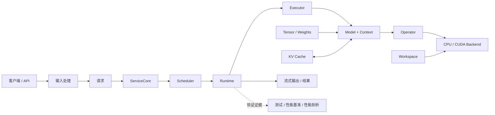

# 推理引擎系统与执行架构

请求路径说明输入怎样经过服务、调度和模型执行，后端路径说明同一算子怎样在 CPU 与 GPU 上实现。遇到状态或资源问题时先沿请求路径定位，遇到数值或性能问题时再沿后端路径定位。

## 训练、推理与服务怎样衔接

系统边界由职责决定，与实现语言无关。训练框架产出模型，推理引擎执行模型，推理服务持续接收、调度并返回请求。

| 系统 | 主要输入 | 核心职责 | 典型输出 |
| --- | --- | --- | --- |
| 训练框架 | 数据、模型定义、优化目标 | 自动求导、优化器、训练和检查点 | 权重与配置 |
| 推理引擎 | 权重、词元、运行配置 | 前向计算、K/V、采样、调度和设备执行 | 词元、logits、运行指标 |
| 推理服务 | 请求、模型实例、资源预算 | 准入、并发、流式输出、协议和观测 | API/SSE 响应与服务指标 |
| 本教程 | 真实模型基线与最小 C++ 契约 | 连接加载器、算子、解码器、运行时和服务核心 | 可读、可改、可验证的单机实现 |

教程提供可运行的单机 CPU 主线和单卡 CUDA 扩展。多进程、模型并行、预填充/解码分离和集群服务用于成熟框架对照。

## 请求经过哪些阶段

| 阶段 | 主要对象 | 输入与输出 | 对应章节 |
| --- | --- | --- | --- |
| 输入处理 | Tokenizer、ModelConfig、ModelLoader | 文本和模型文件 → 词元、配置与权重 | Chapter00–01 |
| 数据与计算 | Tensor、Operator、Backend、Decoder | 词元与权重 → hidden state、logits | Chapter02–05 |
| 生成运行时 | Request、Context、Executor、Runtime | prompt → Prefill、Decode 和生成词元 | Chapter06 |
| 缓存与调度 | BlockTable、Paged K/V、Scheduler | 多请求状态 → 本步执行计划 | Chapter07–08 |
| 验证与归因 | Golden、Benchmark、ProfileRecord | 执行结果 → 正确性与性能证据 | Chapter09 |
| 服务接入 | ServiceCore、HTTP Adapter、ResponseWriter | 外部请求 → Completion 或 SSE | Chapter10 |

系统中的核心调用顺序如下：

```text
ServiceCore
  -> Scheduler
    -> Runtime
      -> Executor
        -> Model + Context
          -> Operator
            -> Backend / Kernel
```

| 对象 | 保存或决定什么 | 主要落点 |
| --- | --- | --- |
| Model | 模型配置、只读权重和 Context 创建规则 | Chapter01、`code/model` |
| Context | 当前请求位置、分层 K/V 和执行状态 | Chapter04、`code/model` |
| Operator | MatMul、Attention、Norm 等数值语义和输入输出约束 | Chapter03–05 |
| Backend | 同一 Operator 的 CPU、CUDA、库或融合实现 | Chapter03、05、`code/cuda` |
| Executor | 把 Runtime 的 Prefill/Decode 调用适配到 Model 与 Context | Chapter06、`code/engine` |
| Runtime | 提交 Prefill/Decode、采样结果和请求终态 | Chapter06 |
| Scheduler | 根据请求状态和资源预算选择本步候选 | Chapter08 |
| ServiceCore | 管理准入、取消、超时和统一释放 | Chapter10 |



## CPU 主线与 GPU 扩展

教程先用 CPU 固定正确性和接口，再在同一套公共接口上接入 GPU。GPU 替换后端、计算核和内存执行路径，不建立第二套请求运行时。多模态则在解码器前增加图片处理，并把统一嵌入序列交给已有 CPU 或 GPU 路径。


| 层 | 共同职责 | CPU 实现 | GPU 实现 |
| --- | --- | --- | --- |
| Core Contract | Shape、Status、所有权与解码器执行语义 | 固定跨章接口 | 保持同一语义 |
| Operator | MatMul、Linear、Attention 的输入输出契约 | 调用 CPU 后端 | 调用 CUDA 后端 |
| Backend | 选择具体执行路径 | 参考实现、融合、SIMD、线程 | cuBLAS、自定义 CUDA 计算核 |
| Kernel | 完成局部数值计算 | 标量、AVX2、线程并行 | GEMV、GQA、RoPE、归约与融合 |
| Decoder | 组合 Embedding、Attention、FFN 和 K/V | CPU 可运行实现 | 复用结构并替换计算路径 |
| Runtime | Prefill、Decode、Sampling 和 Request | 完整主线 | 复用请求推进语义 |

当前 GPU 公共层包含资源 RAII、`CudaTensor`、可复用工作区、`CudaExecutionContext`、cuBLAS MatMul、量化 GEMV、RoPE、连续/分页 K/V 和 GQA Attention。执行上下文持有 stream、handle 和临时显存，上层算子不直接分配设备内存。

## 策略怎样分配到 CPU 与 GPU

请求选择、资源所有权、状态提交和失败回滚先建立平台无关或 CPU 可运行语义；设备内存访问、并行归约和计算核融合再由 CUDA 后端实现。

| 策略 | CPU 或平台无关部分 | GPU 部分 | 当前状态 |
| --- | --- | --- | --- |
| Continuous Batching | 步骤计划、词元/块预算、终态和回滚 | 执行张量批次 | CPU 与真实 CPU/CUDA 批次已接通 |
| Paged K/V | BlockTable、预留、提交、裁剪和回收 | 分页数据与按页表读取的 GQA | CPU/CUDA 单请求和双请求批次已验证 |
| FlashAttention | 三阶段参考结果与分块在线 Softmax | tile、片上存储、Warp 归约与融合计算核 | CUDA 候选实现已通过正确性；端到端收益尚不稳定 |
| Radix Cache | 前缀树、估算/采用、共享块引用和释放 | 复用命中页表读取 K/V | CPU/CUDA Context 采用与缓存感知排序已验证 |
| MTP / 推测解码 | 候选、接受规则和状态回滚 | 并行验证多个候选词元 | 规划中 |
| MLA | 压缩 K/V、位置编码分支与三阶段参考结果 | CUDA 三阶段 MLA 与请求级压缩 Context | CPU/CUDA 真实模型已验证；分页压缩 MLA 与分块 Tensor Prefill 待建设 |
| Prefill/Decode 分离 | 实例角色、路由和 K/V 传输协议 | 各实例的阶段执行 | 集群级扩展参照 |

## 公共接口与验证顺序

`code/core` 提供跨章共享的接口和数据规则，各章保留自己的教学对象和正确性测试。新增后端按以下顺序进入主线：

```text
CPU 参考实现固定输入输出和错误行为
  -> 章节实现适配公共接口
  -> 增加跨章集成测试
  -> GPU 后端复用同一接口
  -> 性能基准固定工作负载
  -> 性能剖析解释计算核、带宽和同步成本
```

| 对象 | 公共接口与当前接入 |
| --- | --- |
| Tensor view | Chapter02 提供 shape、stride、storage offset、dtype 与 device 布局约定 |
| MatMul | Chapter03 通过 `MatmulRequest`、`MatmulBackend` 和 `Status` 接入 CPU 参考实现 |
| Quantized Linear | Chapter05 通过 `LinearRequest` 和后端策略接入标量、AVX2 与 CUDA |
| Decoder | Chapter04 教学层和 `code/model` 真实模型共同适配结构与执行接口 |
| Runtime 资源 | Chapter07–10 通过事务、BatchRunner 和 ServiceCore 交接请求状态 |

默认回归核对 CPU 章节、公共接口和可选资产声明；真实设备数值与性能实验使用 CUDA 和 Chapter09 专用入口。

```bash
bash scripts/run_regression_baseline.sh
CUDA_HOME=/usr/local/cuda-12.8 bash code/cuda/scripts/run.sh
```

## 从问题定位入口

| 观察到的问题 | 先检查 | 阅读入口 |
| --- | --- | --- |
| 词元或模型配置错误 | 分词器、元数据、张量字段模式 | [Chapter01 输入要求](../chapter01_tensor_loader/04_input_contract_and_tokenizer.md) |
| shape 或局部数值错误 | Tensor view、Operator、CPU 参考实现 | Chapter02–04 |
| CPU/CUDA 结果不同 | Operator 接口、Context 位置、Backend | Chapter03–06、[CPU 主线与 GPU 扩展](#cpu-主线与-gpu-扩展) |
| 长上下文结果异常 | position、K/V append、BlockTable | [Chapter06 K/V 语义](../chapter06_generation/next/06_single_request_kv_semantics.md)、[Chapter07](../chapter07_kv_cache/next/intro.md) |
| 多请求卡住或资源未释放 | Request 终态、Scheduler、ServiceCore | Chapter06–08、Chapter10 |
| 性能下降 | 工作负载、阶段计时、热点 | [Chapter09 性能剖析](../chapter09_performance/next/05_profiling_tools.md) |
| HTTP/SSE 行为异常 | Adapter、Writer、终态回调 | [Chapter10 Transport](../chapter10_serving/next/04_transport.md) |

成熟框架怎样实现这些对象，按问题进入[推理生态项目索引](./ecosystem/README.md)。图片输入怎样接入同一执行路径，见[多模态学习计划](../guides/multimodal_learning_plan.md)。
