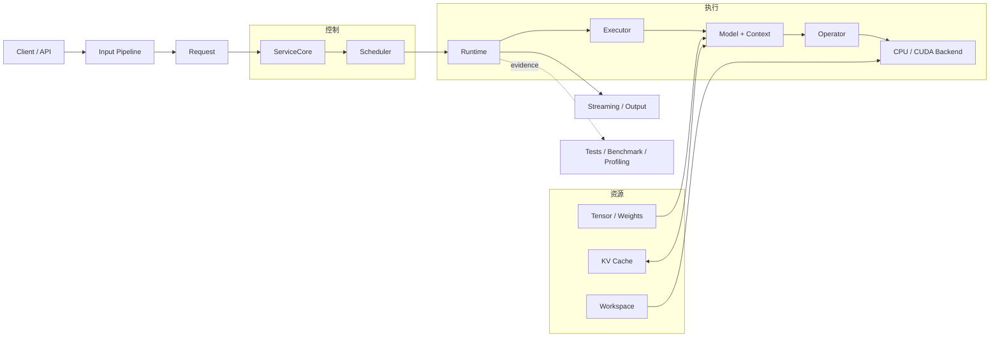

# 推理引擎系统与执行分层

一次请求从输入契约进入服务，经过调度、模型执行、状态提交和输出。系统组件回答“请求经过哪里”，执行对象回答“谁保存权重、谁计算、谁保存请求状态”。两条线放在同一页，便于沿真实调用链定位问题。

## 请求经过哪些阶段

| 阶段 | 主要对象 | 输入与输出 | 对应章节 |
| --- | --- | --- | --- |
| 输入处理 | Tokenizer、ModelConfig、ModelLoader | 文本和模型文件 → 词元、配置与权重 | Chapter00–01 |
| 数据与计算 | Tensor、Operator、Backend、Decoder | 词元与权重 → hidden state、logits | Chapter02–05 |
| 生成运行时 | Request、Context、Executor、Runtime | prompt → Prefill、Decode 和生成词元 | Chapter06 |
| 缓存与调度 | BlockTable、Paged K/V、Scheduler | 多请求状态 → 本步执行计划 | Chapter07–08 |
| 验证与归因 | Golden、Benchmark、ProfileRecord | 执行结果 → 正确性与性能证据 | Chapter09 |
| 服务接入 | ServiceCore、HTTP Adapter、ResponseWriter | 外部请求 → Completion 或 SSE | Chapter10 |

文本与模型输入怎样汇合见[Chapter01 输入契约](../chapter01_tensor_loader/04_input_contract_and_tokenizer.md)；停止条件和长度预算见[Chapter06 请求契约](../chapter06_generation/next/01_request_contract.md)。

## 五类系统组件

| 组件 | 主要职责 | 代表对象 |
| --- | --- | --- |
| 输入 | 把文本、图片和模型文件转换为执行对象 | Tokenizer、GGUF Reader、Vision Encoder |
| 控制 | 管理请求状态、准入和每步选择 | Request、ServiceCore、Scheduler |
| 执行 | 组织模型调用并完成数值计算 | Runtime、Executor、Operator、Backend |
| 资源 | 保存权重、临时空间和请求历史 | Tensor、Workspace、KV Cache、BlockTable |
| 证据 | 判断结果是否正确、性能变化来自哪里 | CTest、Golden、Benchmark、Profiling、Metrics |

请求状态见[Chapter06 生命周期](../chapter06_generation/next/04_request_lifecycle.md)，多请求推进见[Chapter08 Step Batching](../chapter08_scheduling/next/02_step_batching.md)，服务终态见[Chapter10 ServiceCore](../chapter10_serving/next/01_service_core.md)。资源所有权和释放顺序见[内存管理](./memory_management.md)。

## 六个执行对象怎样分工

| 对象 | 保存或决定什么 | 不负责什么 | 主要落点 |
| --- | --- | --- | --- |
| Model | 模型配置、只读权重和 Context 创建规则 | 不保存单个请求位置 | Chapter01、`code/model` |
| Context | 当前请求 position、分层 K/V 和执行状态 | 不选择调度顺序 | Chapter04、`code/model` |
| Operator | MatMul、Attention、Norm 等数值语义和输入输出约束 | 不选择 CPU 或 CUDA | Chapter03–05 |
| Backend | 同一 Operator 的 CPU、CUDA、库或融合实现 | 不改写上层语义 | Chapter03、05、`code/cuda` |
| Executor | 把 Runtime 的 Prefill/Decode 调用适配到 Model 与 Context | 不采样，不管理 waiting 队列 | Chapter06、`code/engine` |
| Runtime | 提交 Prefill/Decode、采样结果和请求终态 | 不决定多请求 admission 和批次顺序 | Chapter06 |

Scheduler 位于 Runtime 外部：它读取多个 Request 和资源预算，选择本步候选，再让 Runtime 或批执行器推进这些请求。ServiceCore 又位于 Scheduler 外部，负责 admission、waiting/running、取消、超时和统一释放。

```text
ServiceCore
  -> Scheduler
    -> Runtime
      -> Executor
        -> Model + Context
          -> Operator
            -> Backend / Kernel
```

CPU reference 和 CUDA backend 应保持 Operator 输入输出、Context 位置和错误行为一致。更换 Backend 不应迫使 ServiceCore、Scheduler 或 Request 理解设备实现。

## 三条观察线

| 观察线 | 起点 | 中段 | 终点 |
| --- | --- | --- | --- |
| 数据 | Chapter01 配置、Tokenizer 与权重 | Chapter02 Storage/View；Chapter04 hidden 与 Q/K/V | Chapter06 Request；Chapter07 BlockTable 与 K/V payload |
| 计算 | Chapter03 Operator/Backend | Chapter04 Decoder；Chapter05 量化 Linear | CUDA kernel；Chapter09 热点归因 |
| 系统 | Chapter00 真实基线 | Chapter06–08 Runtime、缓存与调度 | Chapter09 证据；Chapter10 服务接入 |

实现 Paged K/V 时，数据线定义块布局和所有权，计算线让 Attention 按页表读取，系统线负责容量预算、回滚和终态释放。缺少其中任一条，都不能形成可验证的完整能力。

## 系统结构



## 从问题定位入口

| 观察到的问题 | 先检查 | 阅读入口 |
| --- | --- | --- |
| 词元或模型配置错误 | Tokenizer、metadata、tensor schema | [Chapter01 输入契约](../chapter01_tensor_loader/04_input_contract_and_tokenizer.md)、[模型元数据](../chapter01_tensor_loader/05_model_metadata_and_gguf.md) |
| shape 或局部数值错误 | Tensor view、Operator、CPU reference | Chapter02–04 |
| CPU/CUDA 结果不同 | Operator 契约、Context position、Backend | [CPU/GPU 架构](./cpu_gpu_architecture.md)、Chapter03–06 |
| 长上下文结果异常 | position、K/V append、BlockTable | Chapter06–07、[内存管理](./memory_management.md) |
| 多请求卡住或资源未释放 | Request 终态、Scheduler、ServiceCore | Chapter06–08、Chapter10 |
| 性能下降 | workload、阶段计时、hotspot | [Chapter09 Profiling 工具](../chapter09_performance/next/05_profiling_tools.md)、[热点归因](../chapter09_performance/next/06_hotspot_attribution.md) |
| HTTP/SSE 行为异常 | Adapter、Writer、terminal callback | [Chapter10 Transport](../chapter10_serving/next/04_transport.md)、[SSE 与断连](../chapter10_serving/next/06_sse_disconnect.md) |
