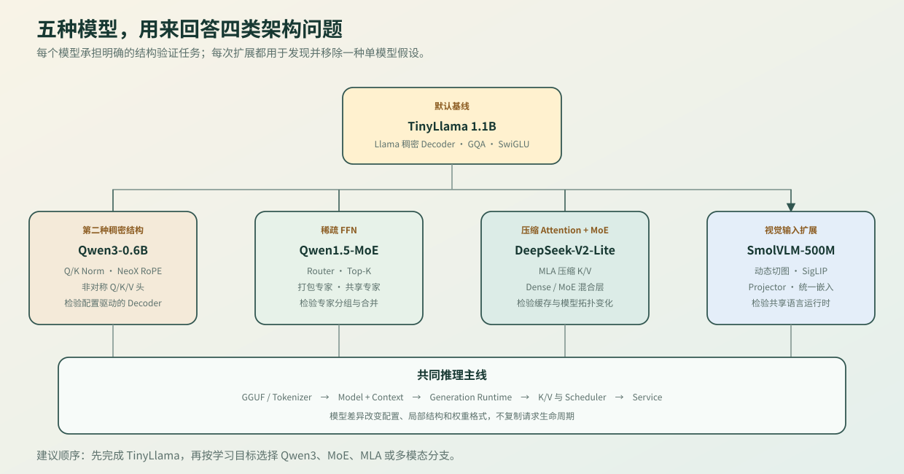
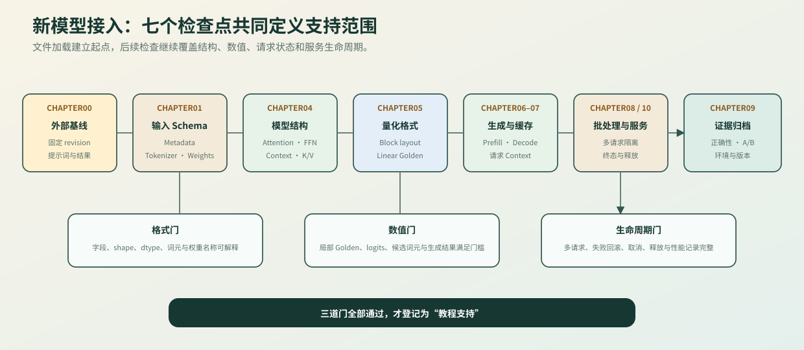

# 模型能力与扩展顺序

本教程使用真实模型检查推理引擎是否摆脱单一架构假设。模型被登记为“教程支持”时，至少需要接通外部基线、Loader、Tokenizer、Decoder 和固定正确性结果；进入服务矩阵还需要验证请求隔离、终态和资源释放。

## 模型怎样扩展学习主线

TinyLlama 固定 Llama 稠密基线，其余模型分别改变归一化与位置编码、FFN 路由、Attention 缓存或输入模态。所有模型共同使用同一请求生命周期和 Runtime 接口。

| 模型 | 主要架构差异 | 在教程中回答的问题 |
| --- | --- | --- |
| TinyLlama 1.1B Chat | 22 层 Llama、GQA、SwiGLU、Q4_K/Q6_K | 最小稠密模型怎样完成 CPU/CUDA 生成与服务 |
| Qwen3-0.6B | Q/K Norm、NeoX RoPE、非对称 Q/K/V 头、共享输出权重 | Decoder 能否由配置构造，而不是写死 Llama 参数 |
| Qwen1.5-MoE-A2.7B | 60 选 4 Router、打包专家、共享专家和混合量化 | 稀疏 FFN 怎样路由、分组执行并合并输出 |
| DeepSeek-V2-Lite | MLA、解耦位置分支、Dense/MoE 混合层、64 选 6 专家 | Attention 与缓存结构变化怎样影响 Runtime 和后端 |
| SmolVLM-500M-Instruct | 动态切图、SigLIP、Projector 和统一嵌入 | 视觉输入怎样接入并复用语言生成主线 |

## 当前模型状态

“已验证”表示仓库存在可运行入口和固定断言；“部分完成”表示主链可运行，但仍有明确交接面未接入；“规划”表示已确定教学价值和准入顺序。

| 模型 | 外部基线与加载 | CPU 生成 | CPU 批处理与服务 | CUDA 生成 | CUDA 批处理与服务 |
| --- | --- | --- | --- | --- | --- |
| TinyLlama 1.1B Chat | 已验证 | 已验证 | 已验证 | 已验证 | 已验证 |
| Qwen3-0.6B | 已验证 | 已验证 | 已验证 | 已验证 | 已验证 |
| Qwen1.5-MoE-A2.7B-Chat | 已验证 | 已验证 | 已验证 | 规划 | 规划 |
| DeepSeek-V2-Lite | 已验证 | 已验证 | 已验证 | 已验证 | 已验证 |
| SmolVLM-500M-Instruct | 部分完成 | 已验证 | 部分完成 | 已验证 | 部分完成 |

SmolVLM 的“部分完成”表示真实资产按需准备，语言服务生命周期和 CUDA 双请求 Decode 组批已经验证；图片 HTTP 传输、服务视觉收集和 Prefill 组批仍待接入。Qwen1.5-MoE 当前以 CPU 分组路径为默认实现，CUDA 专家执行尚未进入支持矩阵。

机器可校验状态登记在 <a href="https://github.com/datawhalechina/cpp-llm-engine/blob/main/code/testing/model_capabilities.json"><code>model_capabilities.json</code></a>。运行 `npm run test:check-model-capabilities` 可检查状态词、入口文件和待办边界；该检查不下载模型，也不执行可选 GPU 路径。

## 新模型怎样进入支持矩阵

文件能够被 GGUF Reader 打开只说明容器可读。模型还要经过结构、量化、生成、生命周期和证据检查，才能进入上面的状态表。

| 检查点 | 主要章节 | 通过条件 |
| --- | --- | --- |
| 外部基线 | Chapter00 | 固定模型 revision、文件校验值、提示词和外部结果 |
| 输入 Schema | Chapter01 | 架构、Metadata、Tokenizer、Tensor 名称、shape 和 dtype 可解释 |
| 模型结构 | Chapter04 | Attention、FFN、位置编码、Context 和 K/V 拓扑通过局部与全层验证 |
| 量化格式 | Chapter05 | 所需 block layout、反量化和 Linear 结果通过 CPU Golden |
| 生成与缓存 | Chapter06–07 | Prefill、Decode、停止词元、请求 Context 和缓存事务成立 |
| 批处理与服务 | Chapter08、10 | 多请求隔离、批执行、取消、失败和终态释放成立 |
| 证据归档 | Chapter09 | 环境、版本、原始样本、正确性门槛与性能结论可复查 |

完整运行顺序由 <a href="https://github.com/datawhalechina/cpp-llm-engine/blob/main/USAGE.md">USAGE</a> 导航，代码入口见 <a href="https://github.com/datawhalechina/cpp-llm-engine/blob/main/code/engine/README.md"><code>code/engine/README.md</code></a> 与 <a href="https://github.com/datawhalechina/cpp-llm-engine/blob/main/code/multimodal/README.md"><code>code/multimodal/README.md</code></a>，固定数值和性能结论统一登记在[实验资产索引](./experiment_assets.md)。

## 当前架构边界

### 稠密模型

TinyLlama 是默认模型，因为 Llama GGUF 字段、Tokenizer、22 层 Decoder、CPU/CUDA Runtime 和服务已经形成完整证据。Qwen3 在同一稠密主线上增加 Q/K Norm、NeoX RoPE、非对称头和共享输出权重，用于验证配置驱动的模型构造；CPU/CUDA 生成、分页缓存、调度和服务均已通过固定结果验证。

### Qwen1.5-MoE

固定 Q3_K_M GGUF 约 7.44GB，包含 24 层和 60 选 4 专家。当前 CPU 路径已经接通真实 Tokenizer、分层 K/V、Router、共享专家、混合量化 Linear、完整生成、跨请求专家分组、调度和动态准入。后续 CUDA 模型支持需要同时覆盖设备端专家权重组织、分组 GEMV、路由元数据和端到端收益；单个专家计算核只构成组件证据。

### DeepSeek-V2-Lite 当前接入层级

固定 Q2_K GGUF 约 6.43GB，包含 27 层、MLA 压缩 K/V、首层 Dense FFN 和后续 64 选 6 MoE。CPU 与 CUDA 已完成 Loader、Q2_K/IQ4_NL Linear、完整 Decoder、Generation Runtime、分页 MLA、跨请求专家分组和文本 HTTP/SSE。当前扩展重点是更长上下文与更大批量压力测试、并发 HTTP 事件循环和 MLA score kernel 优化；具体数值与 Nsight 结果见[实验资产索引](./experiment_assets.md)。

### SmolVLM 多模态

SmolVLM 使用 IDEFICS3 图片路径、SigLIP Vision Encoder 和 Projector，把视觉向量转换为语言模型宽度后进入统一嵌入。CPU 已建立逐阶段 Golden、真实图文生成和服务生命周期；CUDA 已接通完整视觉 tile、双图片视觉组批、图文生成和双请求 Decode 组批。图片网络传输与服务端 Prefill 组批继续由[多模态扩展教程](../extensions/multimodal/intro.md)跟踪。

## 规划模型

| 模型 | 教学价值 | 进入实现前需要满足 |
| --- | --- | --- |
| DeepSeek-R1-Distill-Qwen-1.5B | 验证 Qwen2.5 架构与推理模型 Tokenizer/模板复用 | Qwen 稠密适配链保持稳定，并定义独立固定输出 |
| Gemma | 验证另一套 Metadata、权重名称和 Decoder 配置 | 先完成外部基线与 Chapter01 Schema，不直接复用 Llama 字段 |
| Qwen3-30B-A3B | 学习较新的 MoE 架构与更大专家集合 | 明确消费级设备内存方案，并先通过较小 MoE 的 CUDA 证据链 |

规划状态表示教学价值和接入顺序已经确定。相应 GGUF 仍需从外部基线和输入 Schema 开始，通过完整检查链后再更新支持矩阵。

## 版本与资料

模型接入记录模型仓库、revision、文件校验值、量化类型、Tokenizer 配置和聊天模板，使上游文件更新后仍能复现固定结果。架构参数以发布方资料为准：

- [Qwen3 官方说明](https://qwenlm.github.io/blog/qwen3/)与 [Qwen3-0.6B 配置](https://huggingface.co/Qwen/Qwen3-0.6B/blob/main/config.json)
- [DeepSeek-R1-Distill-Qwen-1.5B 模型卡](https://huggingface.co/deepseek-ai/DeepSeek-R1-Distill-Qwen-1.5B)
- [DeepSeek-V2 官方仓库](https://github.com/deepseek-ai/DeepSeek-V2)
- [Gemma 模型文档](https://ai.google.dev/gemma/docs)与 [gemma.cpp](https://github.com/google/gemma.cpp)
